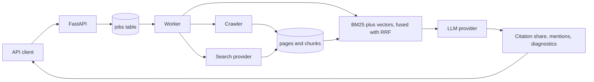

# Ranksim

## Ranksim tester

Ranksim is a test bench for the Google searches you want to win. You give it your site and your key searches (for SmartCrew, a dirt work software company: "all in one dirt work software", "hcss heavyjob alternative" and 14 more). One button pulls Google's REAL top 10 for every search and stores a copy of every page on them, so Ranksim holds a small search engine built from exactly the pages you compete with. Then you upload or paste a page, before you publish it, and see on every search:

- whether the page is on topic, the way the pages Google ranks there are;
- where it is PREDICTED to land among the REAL results, with a likely range;
- which pages and sites sit above that spot, and why;
- what ChatGPT, Claude, Perplexity and Gemini cite for that search and whether they cite you (REAL answers from each engine's API), plus an optional PREDICTED simulation of whether an AI answer built from the Google top 10 would cite your page.

You do not wait days for Google to crawl and index a draft. On SmartCrew's 16 searches a test takes about 3 seconds, a repeat pull about 10 seconds, and a cold pull that had to fetch every page took 37.7 seconds. Every version you test is saved (v1, v2, and so on) and compared with the previous version and with the copy of that URL Ranksim already holds, so you can edit, test again, and keep the better version.

Two labels run through everything. **REAL** is data pulled from Google or an AI engine, always shown with its source and the date and time it was pulled (the committed SmartCrew file says "pull date not recorded", because it does not record one). **PREDICTED** is Ranksim's own guess, never presented as a Google rank. When a key is missing, the result says `not run: needs <ENV VAR>` and nothing else; nothing is invented.

It is a competition: you only get a spot by taking it from a page that holds it now. So the board is about the pages in your way. For each search it lists the REAL top 10 with your page marked where it is PREDICTED to land, and for each page above that spot it shows how many of your searches its site appears in compared with yours, the PREDICTED chance it outranks you, and REAL facts such as how many of the search words its title uses and how long it is. A to-do list ranks what to fix first, from the on-topic check. Read "How accurate is it" below before you act on any slot.

### Quickstart: web UI

```bash
pip install -e ".[dev]"
python -m aeo.ranksim serve
```

Open http://127.0.0.1:8765/ . It listens on this computer only. `--port` changes the port, `--projects-dir` the folder projects are kept in (default `data/projects`). No API key is needed for anything below.

The workspace has three screens, with the project and query carried across them:

1. **Setup** (`/p/<slug>`). Create or pick a project: your site, competitor domains, and observed positions from a `query,url,position` CSV (Search Console's `Query,Page,Position` works too). The CSV is checked line by line before anything is saved, and problems are listed by line. **Load synthetic demo** builds a six-query project from invented `.example` sites with no keys and no network; every page of it is marked SYNTHETIC. On a loopback run, **Load historical SmartCrew export** loads `smartcrew/serp.csv` (pull date not recorded) with only the HTML saved in this repository. The coverage table shows, per query, how many candidates have stored HTML and which are missing. **Fetch pages and build** fetches the candidate pages (robots.txt respected) and trains the model.
2. **Comparisons** (`/p/<slug>/comparisons?q=`). One query: a table of the candidates with the observed position and the PREDICTED position side by side, a shift column, stored-HTML date, and a detail panel with the signals the model reads and the limitations. PREDICTED ranks only order the candidates with stored HTML; missing pages show `n/a`; close calls show `UNSURE`.
3. **Draft test** (`/p/<slug>/draft?q=`). Paste a draft (HTML or plain text), pick the query and the candidate set (all observed candidates, or named competitors only), and keep the original (the stored copy, a pasted original, or none). The result shows original and draft PREDICTED positions among the same candidates, both PREDICTED orders, a fact-by-fact diff, the on-topic check, and the limits of the claim. Each run is saved with its original and draft under `data/projects/<slug>/drafts/`. AI notes are offered only when an LLM key is set; otherwise the page says they are unavailable.

The full older project page (pull log, keys, page tester, results boards, versions, AI engines) is at `/p/<slug>/advanced`.

**Public synthetic demo.** `RANKSIM_PUBLIC_DEMO=1` (or `app.py`, the Vercel entry) serves only the synthetic demo: no project creation, imports, fetching, historical data, or old `/demo` pages, and every provider key is switched off. `.vercelignore` keeps `smartcrew/` out of any upload. On Vercel the data lives in `/tmp` per server instance, so saved draft tests there are not durable; the draft screen says so.

The steps below describe the advanced page.

1. **New project.** A name, your site (for example `www.smartcrewhq.com`), and your key searches, one per line.
2. **Pull now** on the project page. A progress bar per step shows Google, AI engines, crawl, train and save. Without a Google key the Google step says `not run`, and the pull uses REAL results you imported (the **Import Google positions from a CSV** box takes `query,url,position`) or that another project here already holds for the same searches, each with its original source and date.
3. **Test a page.** Upload an `.html` file, paste the HTML, or give a preview URL, and say where the page lives or will live. The result leads with one sentence and four tiles (PREDICTED on topic, PREDICTED top 3, REAL this URL, REAL your site), then "What to change first", "How sure is this?", your versions, the AI engines, a table of every search, and one card per search.

### Quickstart: command line

From a fresh clone, with the committed SmartCrew Google file. No keys are needed:

```bash
pip install -e ".[dev]"
python -m aeo.ranksim project create SmartCrew --site www.smartcrewhq.com --searches "all in one dirt work software" --sitemap-file smartcrew/sitemap_urls.txt --link-graph smartcrew/linkgraph.json
python -m aeo.ranksim project import-serp smartcrew smartcrew/serp.csv --add-searches
python -m aeo.ranksim project pull smartcrew --skip-google
python -m aeo.ranksim project test smartcrew smartcrew/pr8_v3/all-in-one-dirt-work-software.html --url https://www.smartcrewhq.com/all-in-one-dirt-work-software/
```

`--add-searches` adds the file's other 15 searches. The first pull on an empty database crawls about 137 pages. In the cold run on 2026-11-04 that took 37.7 s; Reddit and Facebook refused 12 of the pages in their robots.txt and 7 more answered HTTP 403 or 404, and those results are listed as not stored, never invented.

For your own site, once a Google key is set:

```bash
export SERPAPI_KEY="your-key"
python -m aeo.ranksim project create "My Site" --site www.example.com --searches "first search; second search"
python -m aeo.ranksim project pull my-site
python -m aeo.ranksim project test my-site draft.html --url https://www.example.com/new-page/
```

More:

```bash
python -m aeo.ranksim project test smartcrew https://www.smartcrewhq.com/all-in-one-dirt-work-software/
python -m aeo.ranksim project test smartcrew draft.html --url https://www.smartcrewhq.com/all-in-one-dirt-work-software/ --json --fail-on-regression
python -m aeo.ranksim project pull smartcrew --engines chatgpt,claude --runs 3 --brand SmartCrew
python -m aeo.ranksim project engines smartcrew
python -m aeo.ranksim project show smartcrew
python -m aeo.ranksim project list
python -m aeo.ranksim project searches smartcrew --add "dirt work software" --remove "b2w alternative"
```

A URL source is fetched politely (robots.txt respected, private addresses refused). `--fail-on-regression` exits 1 when the page stops being on topic for a search where the stored copy or the previous version was. `--no-save` tests without recording a version, `--no-sim` skips the AI simulation, and `--details -1` explains every page above you. `--searches-file FILE` takes one search per line. Every `project` subcommand takes `--projects-dir`; `--database URL` goes before `project`.

### Keys: what each one unlocks

Set keys as environment variables, or in a `.env` file in the folder you run from. Their values are never shown.

| Env var | Unlocks | Without it |
| --- | --- | --- |
| `SERPAPI_KEY`, or `DATAFORSEO_LOGIN` and `DATAFORSEO_PASSWORD`, or `SERPER_API_KEY` (tried in that order) | A fresh REAL Google top 10 for every search on each pull | The Google step reads `not run: needs SERPAPI_KEY, SERPER_API_KEY, or DATAFORSEO_LOGIN and DATAFORSEO_PASSWORD`. Pulls reuse saved, imported or another project's REAL results, with their original dates. A new project with none of those stops and names these keys. |
| `OPENAI_API_KEY` (a real OpenAI key; an OpenRouter `sk-or-` key does not count here) | The ChatGPT row: a REAL answer and its citations from the OpenAI Responses API with web search | `ChatGPT: not run: needs OPENAI_API_KEY` |
| `ANTHROPIC_API_KEY` | The Claude row (Messages API with the web search tool) | `Claude: not run: needs ANTHROPIC_API_KEY` |
| `PERPLEXITY_API_KEY` | The Perplexity row (Agent API, Sonar model) | `Perplexity: not run: needs PERPLEXITY_API_KEY` |
| `GEMINI_API_KEY` | The Gemini row (Interactions API with Google Search) | `Gemini: not run: needs GEMINI_API_KEY` |
| `OPENROUTER_API_KEY`, else `OPENAI_API_KEY`, else `ANTHROPIC_API_KEY` | The PREDICTED AI answer simulation in a page test | `not run: needs OPENROUTER_API_KEY, OPENAI_API_KEY or ANTHROPIC_API_KEY` |
| `BRAVE_API_KEY` | Not used by projects: Brave's order is not Google's | n/a |

With no key at all, the page test still works on REAL results you import: the on-topic check, the PREDICTED slot and its range, the pages above you, the to-do list, versions and compare. Bing Copilot is not covered: no public API returns its answer citations, so nothing is shown for it.

The AI engines are paid APIs. Each answer records its estimated cost from a dated rate table in `src/aeo/ranksim/engines.py`. The simulation is off by default in the web UI, which shows its call count first (on SmartCrew, 16 searches x 3 runs x with and without your page = 96 LLM calls) with a labeled estimate. None of these paths has run against a live API yet: no keys exist in this environment, so the Google pull, the four engines and the simulation are tested only against fakes shaped like each API's documented responses.

### How accurate is it

**No tool can know where Google will rank a page before Google ranks it.** Google uses signals that are not on the page: links from other sites, the reputation of the whole site, and how searchers click on results (testimony in the US v. Google trial describes Navboost, built on about 13 months of click data; see `docs/accuracy.md`). Ranksim cannot see those. What it does is predict, and prove its own hit rate: every board and the project page print a backtest recomputed from that project's REAL results.

**How the hit rate is measured (the insertion backtest).** Take one search and hide one of its REAL results. Ask the predictor where that page goes among the search's other REAL results, whose order is known. Do it for every result of every search, and never let the model train on the search it is predicting. The miss is how many places the predicted slot is from the true one. The bar to beat is "always guess the middle of the list".

Measured on SmartCrew's 16 searches by the accuracy lab on 2026-11-04 (128 stored REAL pages; the hidden page's URL removed from training; 95% bootstrap intervals over searches in brackets):

| Predictor | Average miss | Within 2 places | Exactly right |
| --- | --- | --- | --- |
| Site history, the headline PREDICTED slot | 1.83 places [1.60 to 2.02] | 68% | 17% |
| Always the middle of the list | 2.02 places | 62% | 12% |
| Content model, the old slot, which reads the page text | 2.57 places | 54% | 15% |
| A random guess | 2.68 places | 53% | 12% |

By kind of page:

- **A brand-new site** (one that appears in none of the other searches; 28 pages): site history misses by 1.43 places [1.03 to 1.81] and lands within 2 places 86% of the time. The middle guess misses by 2.39.
- **A new page on a site that already ranks for other searches**, which is SmartCrew's case: 1.88 places against 1.92 for the middle guess. The difference, -0.04 [-0.18 to +0.08], is noise. For SmartCrew's next page the slot is no better than guessing the middle, and the board says so.
- **What the board prints today** (all 135 REAL results, including the 7 with no stored copy): off by 2.0 places on average, within 2 places 64% of the time, exactly right 15%; the middle guess is off by 2.1 and within 2 places 59%. The likely range on the board is the slot plus or minus 3 places, the miss the backtest stayed within 80% of the time.

What that means for you:

- **Trust** the REAL results and AI citations (they are data, with dates), and the list of pages and sites you are up against. Treat the on-topic check as a floor: 119 of 120 readable REAL top 10 pages pass it, and a chocolate cake recipe fails all 16 searches. It has never been tested on pages that failed to rank, because the data holds none.
- **Read the slot as rough.** It comes from which sites keep showing up across your searches, so it does not move when you edit the page.
- **Not yet:** whether an edit moves you up, and whether a page makes the top 10 at all. Inside Google's top 10, every on-page signal measured so far orders pages no better than a coin flip. Pairwise agreement with Google's order, where 0.5 is a coin flip: title match 0.465, embedding similarity 0.463, the content model 0.524. How many of your searches a site appears in scores 0.684. The content model's slot is still shown, labeled "content model (unvalidated)": in the same backtest it misses by 2.5 places against 2.0 for the middle guess.

What makes it more accurate:

1. **More searches, across different topics.** The site signal improved as the lab gave it more training searches (pairwise 0.627 with 4 searches, 0.687 with 15) and then flattened, because SmartCrew's 16 searches are near duplicates of one topic. Hundreds of searches across distinct topics are what can move it.
2. **Fresh and deeper pulls.** Repeated pulls of the same searches measure how much Google reshuffles on its own. That noise floor is unknown today, because the only file has no pull date. Positions 11 to 100 add the pages that did not make page one, which is what it takes to test "will it make the top 10" at all.
3. **Backlink and authority data** per page and per site. Link and site signals are the only family with measured signal here, and the link graph Ranksim builds from its own crawl is sparse.
4. **The publish then track scorecard.** Freeze each tested version's PREDICTED slot, publish the page, pull again over the following weeks, and grade the call against the REAL position. It is the only way to learn whether content edits move rank, and the only honest basis for ever saying the tester knows. It is not built yet.

### Not built yet

- The publish then track scorecard above.
- Automatic rewriting inside projects. An `optimize` loop exists for the older single-page tester (below), but it rewrites toward the content model, which the backtest shows is no better than guessing, so it is not wired into projects.
- Hosting. The web UI runs on your computer, with no login.
- Bing Copilot.

# AEO Simulator (older API, parked)

This is the older answer-engine sandbox API. It is parked; the Ranksim tester above is the product. See `docs/accuracy.md` for how the Google ranker is built.

A sandbox search and answer engine for answer-engine optimization. You submit a site and the questions you want to win. The service indexes those pages, pulls a competitor set, expands each question into sub-queries, and writes several grounded answers. It then reports how often the submitted domain was cited or mentioned, why a page is losing, and how a draft or re-crawl changes that.

These are sandbox results. `answers_are_official_engine_results` is always `false`. The simulator does not pretend to be ChatGPT, Perplexity, or Google AI Overviews. Log what those products actually did on `POST /v1/calibration` if you want to measure whether the sandbox tracks them.

## Why Python

The core of this service is document processing and ranking: robots-aware fetching, HTML extraction, Okapi BM25, cosine similarity, and reciprocal rank fusion. Python's HTTP, parsing, and numeric libraries make that path short and testable. FastAPI turns the same types into the OpenAPI document at `/docs`. A TypeScript service would need extra libraries for BM25 and HTML extraction without making the scoring easier to verify.

## Architecture



1. **Index.** `POST /v1/simulations` accepts a site URL, an optional sitemap, or pasted HTML. A worker fetches raw HTML (no JavaScript unless Playwright is installed and `render_js` is true), respects `robots.txt`, and stores title, meta description, canonical, headings, main text, JSON-LD, links, and dates. Text is split into passages. SQLite stores them in FTS5. Postgres also stores a `tsvector` and a `pgvector` column.
2. **Competitors.** For each question the search provider returns top results. The Brave adapter (`BRAVE_API_KEY`) returns live URLs, which are fetched and indexed. The mock adapter returns synthetic HTML and labels it `synthetic: true`. If no provider is configured, the run does not invent a SERP.
3. **Fan-out.** The LLM expands the question into sub-queries. The original question is always kept. Each sub-query is retrieved with Okapi BM25 and cosine similarity, then the lists are fused with reciprocal rank fusion (`1 / (60 + rank)`). A second fusion step merges the sub-queries.
4. **Answers.** The LLM writes one grounded answer per run (default 5) using only the fused passages, cited as `[S1]`. Unknown markers are recorded and dropped. Citation share is the fraction of runs whose citations include the submitted domain. Mention rate is the fraction whose prose names the domain or its first label, outside the citation markers.
5. **Diagnostics.** Each question is labeled `likely_cited`, `missing_page`, `weak_page`, `crawl_index_issue`, or `third_parties_dominating`, plus raw-HTML checks: h1, title, meta description, canonical, text present in the raw document, word count, updated date, and an answer-first opening.
6. **A/B.** `POST /v1/questions/{id}/ab` snapshots the current runs, applies a pasted HTML draft or a re-crawl, runs the question again against the same sub-queries and competitor set, and returns the before/after diff.
7. **Calibration.** `POST /v1/calibration` stores an observation you made in a real engine. `GET /v1/calibration/accuracy` scores those rows against the citation share that was on the question at log time. With no rows, accuracy is `null`.

Ranking of a question's in-scope passages (the site plus that question's rivals) is done in process, so SQLite and Postgres produce the same order. The Postgres `embedding vector(N)` column and `tsvector` are written on index so a larger corpus can prefilter later. FTS5 is the SQLite full-text index; Okapi BM25, not the database rank function, is what the tests lock.

Jobs live in the `jobs` table. Postgres workers claim with `FOR UPDATE SKIP LOCKED`. Use one worker with SQLite. `PROCESS_JOBS_INLINE=true` runs jobs inside the API process; do not start a worker as well.

The crawler allows only `http` and `https`, refuses credentials, and blocks private, loopback, and link-local addresses unless `CRAWL_ALLOW_PRIVATE=true`. It also checks resolved addresses before connecting.

## Setup

```bash
python -m venv .venv
source .venv/bin/activate
pip install -e ".[dev]"
cp .env.example .env
pytest
python examples/run_local.py
```

The example runs in-process with the mock search, mock LLM, and hashing embedder. It indexes pasted HTML for `https://northwind.example` (nothing is fetched), asks one question the page answers and one it does not, then replaces the page with an off-topic draft and prints the diff.

API server, with a separate worker:

```bash
mkdir -p data
export DATABASE_URL=sqlite:///./data/aeo.db
export SEARCH_PROVIDER=mock LLM_PROVIDER=mock EMBEDDING_PROVIDER=mock
export PROCESS_JOBS_INLINE=false CRAWL_DELAY_SECONDS=0
uvicorn aeo.main:app --app-dir src --host 127.0.0.1 --port 8741
# second shell, same environment
python -m aeo.worker
python examples/run_local.py --base-url http://127.0.0.1:8741
```

Interactive docs: [http://127.0.0.1:8741/docs](http://127.0.0.1:8741/docs). The OpenAPI document is also committed as `openapi.json`.

### Docker Compose

Postgres with pgvector, the API, and a worker. Compose defaults to the mock providers so it does not call Brave or OpenAI unless you set the variables.

```bash
SEARCH_PROVIDER=mock LLM_PROVIDER=mock EMBEDDING_PROVIDER=mock docker compose up --build
```

The API listens on port `8741`. Postgres is published on `54329`.

To use live competitors and a real model, set `BRAVE_API_KEY`, `OPENAI_API_KEY`, `SEARCH_PROVIDER=brave`, `LLM_PROVIDER=openai`, and, for API embeddings, `EMBEDDING_PROVIDER=openai` plus `EMBEDDING_DIM` matching the model (`1536` for `text-embedding-3-small`). Mismatched dimensions fail the job instead of silently mixing vector spaces. Answers from that model are still sandbox answers over this retriever, not official ChatGPT, Perplexity, or Google AI Overview responses.

JavaScript rendering is optional. Install Playwright and Chromium yourself, then pass `"render_js": true`. If Playwright is missing, the job indexes raw HTML and says so. It does not invent a rendered DOM.

## Example

`python examples/run_local.py` prints a report like this (mocks only):

```text
answers_are_official_engine_results: False
providers: search=mock llm=mock embeddings=mock synthetic=True
compared_against_live_web: False

Q: What is the best trail mix for long hikes?
  diagnosis=likely_cited  citation_share=0.8  mention_rate=0.8  mean_position=1.0
  raw html: h1=True title=True meta=True canonical=True text_in_raw_html=True words=142 updated=True answer_first=True

Q: What is the capital of France?
  diagnosis=missing_page  citation_share=0.0  mention_rate=0.0

A/B draft that removes the trail-mix answer
  citation share 0.8 -> 0.0 (-0.8)
  diagnosis      likely_cited -> missing_page
  improved=False
```

The 0.8 share is the mock LLM's fixed variation: the top passage is cited on 4 of 5 runs. It is not a prediction sampled from a production answer engine. Competitor pages in this run are synthetic stubs, not live rankings.

A minimal create call:

```bash
curl -s -X POST http://127.0.0.1:8741/v1/simulations \
  -H 'content-type: application/json' \
  -d @- <<'JSON'
{
  "site_url": "https://northwind.example",
  "pages": [{
    "url": "https://northwind.example/trail-mix",
    "html": "<html><head><title>Best trail mix for long hikes | Northwind</title><meta name=\"description\" content=\"Salt and almonds for long hikes.\"><link rel=\"canonical\" href=\"https://northwind.example/trail-mix\"></head><body><h1>Best trail mix for long hikes</h1><p>The best trail mix for long hikes is almonds, pumpkin seeds, and salt. Northwind packs this trail mix for long hikes.</p></body></html>"
  }],
  "questions": ["What is the best trail mix for long hikes?"],
  "n_runs": 5,
  "search_provider": "mock",
  "llm_provider": "mock"
}
JSON
```

With `PROCESS_JOBS_INLINE=false`, poll `GET /v1/simulations/{id}` or `GET /v1/jobs/{job_id}` until `status` is `completed` or `failed`.

Record a real observation after you have checked an engine yourself:

```bash
curl -s -X POST http://127.0.0.1:8741/v1/calibration \
  -H 'content-type: application/json' \
  -d '{"engine":"chatgpt","question_id":"QUESTION_ID","cited":true,"mentioned":true,"citation_position":1,"notes":"Checked by hand."}'
curl -s http://127.0.0.1:8741/v1/calibration/accuracy
```

The stored `predicted_citation_share` is copied from the question at log time. Later re-runs do not rewrite it.

## API

| Method | Path | Purpose |
| --- | --- | --- |
| `GET` | `/health` | Process and database dialect |
| `GET` | `/v1/providers` | Resolved providers, key presence, mock warnings |
| `POST` | `/v1/simulations` | Index a site and run questions |
| `GET` | `/v1/simulations/{id}` | Status and full results |
| `POST` | `/v1/sites` | Index only |
| `GET` | `/v1/sites/{id}` | Indexed pages |
| `POST` | `/v1/sites/{id}/questions` | Run questions against an indexed site |
| `GET` | `/v1/pages/{id}` | Extracted page; `?include_html=true` adds raw HTML |
| `POST` | `/v1/questions/{id}/ab` | Draft or re-crawl, then diff |
| `GET` | `/v1/ab/{id}` | A/B status and diff |
| `POST` | `/v1/calibration` | Log a real engine observation |
| `GET` | `/v1/calibration/accuracy` | Accuracy, precision, recall, Brier score |
| `GET` | `/v1/jobs/{id}` | Queue job |
| `GET` | `/ranksim` | SmartCrew Google rank report (predicted only) |

`search_provider` is `auto`, `brave`, `mock`, or `none`. `llm_provider` and `embedding_provider` are `auto`, `openai`, or `mock`. `auto` uses the live adapter only when the matching API key is set. `brave` or `openai` without a key returns 400 and does not fall back to the mock.

## Configuration

See `.env.example`. The important switches are `DATABASE_URL`, `SEARCH_PROVIDER`, `BRAVE_API_KEY`, `LLM_PROVIDER`, `OPENAI_API_KEY`, `OPENAI_BASE_URL`, `OPENAI_MODEL`, `EMBEDDING_PROVIDER`, `EMBEDDING_DIM`, and `PROCESS_JOBS_INLINE`.

`OPENAI_BASE_URL` can point at any OpenAI-compatible chat and embeddings server.

## Tests

```bash
pytest
```

They cover Okapi BM25 (including a hand-checked `log(2)` score), reciprocal rank fusion, hybrid ordering, fan-out parsing, citation position and mention rate, the mock run-to-run variation, diagnostic branches, before/after diffs, calibration with an empty log and with known pairs, robots.txt, private-address blocking, the Brave and OpenAI request shapes, and an API run that recomputes citation share from the mock policy. Network is not required. Mock output is flagged `synthetic`.

## Google rank simulator (SmartCrew)

Run it locally:

```bash
pip install -e ".[dev]"
python -m aeo.ranksim serve
```

Then open http://127.0.0.1:8765/ . That is the projects web UI (see "Web UI" below). The old single-query demo is at http://127.0.0.1:8765/demo and still answers `POST /check`. The first time the demo opens, on an empty database, it loads the committed HTML in `smartcrew/saved_html` and `smartcrew/pr8_v3`. It does not crawl and it does not invent the pages that are not in those files.

The AI eval, after you export a key:

```bash
export OPENROUTER_API_KEY="your-key"
bash scripts/ai_eval.sh
```

`OPENAI_API_KEY` is used for OpenRouter when the key starts with `sk-or-`. Otherwise a normal OpenAI key uses `gpt-4o-mini`, and `ANTHROPIC_API_KEY` uses `claude-3-5-haiku-20241022`. Set `RANKSIM_LLM_MODEL` to override. OpenRouter's default model is `openai/gpt-4o-mini`. Calls are cached in `data/llm-cache/` and the estimated cost is appended to `data/llm-cost.jsonl`.

A separate loop for `www.smartcrewhq.com`. Stage 1 retrieves with BM25F over title, URL, H1, headings, body, and anchor text. Stage 2 is LambdaMART (LightGBM) using the features in `docs/accuracy.md`. Predicted positions are scores on our index. They are not live Google ranks. Default weights are a published-practice prior. They are replaced only when you train on a real position file.

The keyword file is `smartcrew/keywords.csv` (150 queries: intent, suggested target page, and whether that URL is in the sitemap snapshot from 2026-10-29). 113 queries map to a page that exists. 37 are page gaps. Regenerate with:

```bash
python -m aeo.ranksim keywords
python -m aeo.ranksim gaps
```

`keywords --refresh-sitemap` refetches `https://www.smartcrewhq.com/sitemap.xml` and rewrites the snapshot. It does not invent URLs.

### Projects reference (the details behind the Ranksim tester)

The Ranksim tester section at the top is the plain-language version of this one. A project is your site plus the searches that matter to you. A pull records the REAL Google top 10 for every search, stores every result page in the shared rank database (`data/ranksim.db`, reused across projects), and trains a mini search engine on that set. Then you test a page, as a local file or a preview URL, and see where it would slot in on every search in seconds instead of waiting for Google to index it.

```bash
# 1. Create the project.
python -m aeo.ranksim project create SmartCrew --site www.smartcrewhq.com --searches "all in one dirt work software; hcss heavyjob alternative"

# 2a. Pull the REAL Google top 10 now. Needs SERPAPI_KEY, SERPER_API_KEY, or DATAFORSEO_LOGIN and DATAFORSEO_PASSWORD.
python -m aeo.ranksim project pull smartcrew

# 2b. Or seed REAL results you already have (query,url,position), then crawl and train without calling Google.
python -m aeo.ranksim project import-serp smartcrew smartcrew/serp.csv --add-searches
python -m aeo.ranksim project pull smartcrew --skip-google

# 3. Test a page. Every search, every time. --json for a UI or CI, --fail-on-regression to block a version that
#    stops being on topic for a search (--fail-on-content-regression also fails on the unvalidated content model).
python -m aeo.ranksim project test smartcrew draft.html --url https://www.smartcrewhq.com/all-in-one-dirt-work-software/

# AI engines: a pull also asks ChatGPT, Claude, Perplexity and Gemini (each one that has a key) every search.
python -m aeo.ranksim project pull smartcrew --engines chatgpt,claude --runs 3
python -m aeo.ranksim project engines smartcrew

python -m aeo.ranksim project show smartcrew
python -m aeo.ranksim project list
python -m aeo.ranksim project searches smartcrew --add "dirt work software" --remove "b2w alternative"
```

**What is REAL and what is PREDICTED.** The Google results are REAL and always carry their source and pull time. `smartcrew/serp.csv` is labeled `smartcrew/serp.csv (committed 2026-10-29, pull date not recorded)`. Pass `--snapshot-date YYYY-MM-DD` to `import-serp` when you know the day. Where your page slots in is PREDICTED. The incumbents keep their REAL order and the model only decides where your page goes.

**The on-topic check comes first.** Google's top 10 is already filtered for relevance, and within it no on-page signal measured here orders pages. What the REAL top 10 pages do share is that they are about the search, so every search starts with a PREDICTED on-topic check (`src/aeo/ranksim/relevance.py`): does the page use at least as many of the search's words as the readable REAL top 10 page that uses the fewest (never more than half of them), is its vocabulary close enough to those pages (TF-IDF cosine, floor at half the lowest match any REAL top 10 page has with the others), and does it avoid repeating itself (distinct 3-word sequences, floor far below the most repetitive REAL page)? A page that fails gets no slot and is PREDICTED not to make the top 10 there; an empty page is "not checked". The check is backtested on the REAL pages themselves, each against the others (on SmartCrew 119 of 120 readable REAL top 10 pages pass), and the board says plainly that it was never tested on pages that failed to rank, because the data holds none. A chocolate cake recipe is off topic on all 16 SmartCrew searches; a keyword-stuffed page is flagged as repetitive; the SmartCrew homepage is off topic for three of the alternative searches (hcss heavyjob, hcss heavybid and b2w alternative), whose product names it never uses. The board ranks a to-do list from the check (the missing search words, ordered by how many searches they affect) plus what most REAL top 10 titles have that yours lacks, labeled as a shared trait, not a proven ranking lever. `--fail-on-regression` fails when a version stops being on topic for a search where the stored copy (or the previous version) was.

**Which PREDICTED slot leads, and how accurate it is.** The headline slot comes from site history (`src/aeo/ranksim/site_history.py`): a two-parameter pairwise logistic model on how many of the project's other searches list your site, and each incumbent's site, in their REAL top 10. The accuracy lab tested it against the old default (1 plus the stored incumbents the content model scores above you) with each search held out, and it beat the default beyond noise in every setting: about 0.6 to 1.0 places closer on average (new URL 1.83 vs 2.57; brand new site 1.43 vs 2.39; 95% bootstrap intervals all below zero). The old default could not be told apart from a random guess and was worse than always guessing the middle. Every board and the project page print this predictor's own backtest, recomputed from the project's REAL results each time the engine loads (`site_history_backtest`), for example on SmartCrew today: "In backtests this predictor put a hidden page within 2 places of its REAL Google position 64% of the time (135 REAL results over 16 searches, each search held out). It was off by 2.0 places on average ... Always guessing the middle is off by 2.1." Site history is content blind: editing the page text does not move it, and the board says so next to it. The content model slot is still computed (`SearchBoard.predicted_position`, `insertion_position`, pluggable) and shown as "content model (unvalidated)" with its own measured backtest (off by 2.5 places vs 2.0 for the middle guess). Changes in the content model between versions (and `--fail-on-content-regression`) are a smoke test. The pages above your slot are explained by what actually sets it: how many of your other searches list their site and yours (REAL counts), the PREDICTED chance they rank above you, and REAL facts (search words in the title, word count). A page of your own site above the slot is called out as one a new page would compete with. For a new page on a site that already ranks elsewhere (SmartCrew's case) the board prints that backtest group on its own: off by 2.1 places against 2.2 for always guessing the middle, so no better than the middle. Slots are shown as Google positions implied by the REAL neighbors ("#4", or "#3 to #7" across a gap in the REAL list, or "#6 or lower" past it); only REAL positions 1 to 10 are used to place a page. REAL results with no stored HTML are listed, not scored by the content model; site history still places your page among them, since it needs only the REAL result list. With no Google key and no imported results, `pull` stops and names the env vars. A search with no REAL results shows `not run: needs SERPAPI_KEY, SERPER_API_KEY, or DATAFORSEO_LOGIN and DATAFORSEO_PASSWORD`. Nothing is invented.

**Reading the project board.** The board leads with one sentence (on topic for X of N searches, top 3 on Y of them from your site's track record, and the REAL positions with their pull date). The summary line reads `PREDICTED top 3 on X of N searches, top 10 on Y of N. REAL (pull date): top 10 on Z of N.` An off-topic search counts as not in the top 10. The tester places a page only among pages that already made the top 10, so it cannot say whether a page makes page one at all, and the board says so. Then a to-do list from the on-topic check, the accuracy lines, and one row per search: on topic or not, the PREDICTED slot (site history) and its likely range, the content model's slot, this URL's REAL position, and the change against the stored copy of the URL and against the previous version (both rescored now on the same engine; those changes come from the content model and are unvalidated). Under each search: the on-topic check, the PREDICTED slot between its REAL neighbors, the REAL top 10 with your page marked where it slots in, why the pages above your slot are there, the content model's slot with UNSURE or CLEARER and the independent linear check, how many REAL results are stored (THIN under half), the per-search backtest, and the AI engine rows. When the URL already ranks, a check line compares the PREDICTED slot with its REAL position, which shows how far off the predictor is on that search (on "hcss heavyjob alternative" the HCSS comparison page is PREDICTED #4 and is REAL #7, 3 places optimistic). The content model's order backtest on the SmartCrew file is pairwise 0.528 on 458 pairs, barely better than a coin flip.

**AI engines.** `pull` also asks every key search, as a person would type it, to ChatGPT (OpenAI Responses API, web search), Claude (Messages API, web search tool), Perplexity (Agent API) and Gemini (Interactions API, Google Search), each one that has its key (`--engines`, `--runs N` repeats, `--brand`, `--fresh-engines` to skip the same-day cache). The step runs in a background thread alongside the crawl and the training. The REAL answers are saved in the pull folder as `engines.json` with the model served, the pull time, the cited URLs in order, whether your domain is cited and where, and whether your brand is named. An engine without its key is recorded as `not run: needs OPENAI_API_KEY` (or `ANTHROPIC_API_KEY`, `PERPLEXITY_API_KEY`, `GEMINI_API_KEY`) and nothing else. `project engines NAME` and each board show the newest REAL answers per engine and search, from whichever pull last got them, with that pull's time. Bing Copilot is not covered: no public API returns its answer citations. When an LLM key is set (`OPENROUTER_API_KEY`, `OPENAI_API_KEY` or `ANTHROPIC_API_KEY`), `project test` also runs the PREDICTED simulation per search (`--sim-runs 3`, `--no-sim`): our own LLM answers from the stored Google top 10 plus your page, with all page text fenced and escaped as data, and the board reports how often it cites your page. It is labeled as our model, never as the real engine.

**Pulls.** `pull` runs four timed steps: google, crawl, train, save, plus the engines step in the background (`PullReport.engines_step`). The crawl fetches every result URL and your own pages (results on your domain, pages already stored for it, `--sitemap-file` or `/sitemap.xml`) that are not stored or are older than `--fresh-days` (7). It runs hosts in parallel, respects robots.txt, refuses private addresses, and records a status per URL: stored, fetched now, blocked by robots, HTTP 403, or error. A failed refresh never erases a stored copy. Each pull is saved in `data/projects/<slug>/pulls/<UTC timestamp>/` as `google.json`, `pull.json` (statuses, step timings, backtest), and `engine/`, so `project test` loads the engine in about a second instead of retraining. Tested versions go to `data/projects/<slug>/tests/`.

### Web UI

```bash
python -m aeo.ranksim serve                 # http://127.0.0.1:8765/ , this computer only
python -m aeo.ranksim serve --host 0.0.0.0  # reachable from the network, with no login: only on a trusted network
# A wider bind still checks the Host header: IP addresses, localhost and names given with --allow-host only (blocks DNS rebinding).
```

One page per project: its searches with REAL result and stored counts, the last pull time and step timings, the measured accuracy, a big **Pull now** button (runs the pull in a background thread with a live progress bar per step), and **Test a page** (upload an `.html` file, paste HTML, or give a preview URL, plus the URL the page will live at). The result page leads with one plain sentence and four tiles (PREDICTED on topic, PREDICTED top 3, REAL this URL, REAL your site, each REAL tile with its pull date), then "What to change first" (the ranked to-do list), "How sure is this?", your versions (on-topic losses first; content-model moves folded away as unvalidated), the AI engines (engines without a key on one line; instruction-like text found in simulation sources shown as a warning), a table of every search, and one collapsible card per search: the on-topic check, the REAL top 10 with its source and pull date, your page highlighted at its PREDICTED slot with the likely range, why the pages above your slot are there, and the REAL citations per AI engine. The page URL is required (https:// is added to a bare address). With no Google key, Pull now reuses saved REAL results, or copies another project's REAL results for the same searches with their source and pull date, says that Google was not asked, and reuses the last engine when nothing changed. Saving searches or importing a CSV while a pull runs answers at once with "try again" instead of freezing the server. Versions of each URL are listed with a compare view that rescores two versions on the same engine. Results are saved in `data/projects/<slug>/results/`.

Security: it binds 127.0.0.1 by default and then rejects other Host headers (DNS rebinding), every form carries a per-process CSRF token, request bodies and uploads are capped at 5 MB, every crawled, pulled or uploaded string is HTML-escaped and links are only made for http(s) URLs, the Content-Security-Policy allows no inline script, preview URLs go only through the robots-respecting, SSRF-safe `Crawler` (private addresses refused), and key values never appear in pages, job messages or logs (configured keys are scrubbed from any error text).

**Measured on 2026-11-04** (16 searches, 139 URLs, pages already stored). Web UI: Pull now took 10.8 s from the click to the refreshed page when it retrained the engine, and 2.3 s when nothing had changed and the last engine was reused; Test a page took 3.6 s from the click to the full results for all 16 searches. Command line: create 0.6 s, import 0.7 s, pull with `--skip-google` 10.1 s (crawl 1.3 s, train 7.9 s), `project test` 3.0 to 3.4 s wall for all 16 searches. A cold pull into an empty database took 37.7 s (crawl 29.6 s, train 7.2 s); on that crawl 12 Reddit and Facebook results were blocked by robots.txt and 7 returned HTTP errors, so 30 REAL results had no stored HTML. The Google API step has not been timed, because no key is set here.

### Sandbox tester and optimize loop

`tester` puts one version of a page into the stored competitor set and scores it on its target queries in under a second, after a few seconds of model loading. You edit the page, the tester re-indexes and re-scores it, and you see which version does better before anything is published. `optimize` is the rapid iteration version: it rewrites the page, scores each version, and keeps the best one until every target query is PREDICTED at `--goal` or better, or a stop rule ends the run.

```bash
# A local draft. --url is the page the draft will replace.
python -m aeo.ranksim tester draft.html --url https://www.smartcrewhq.com/compare/hcss-heavyjob-alternative/

# A preview or staging deploy, scored as the canonical page.
python -m aeo.ranksim tester https://preview.example.com/compare/hcss-heavyjob-alternative/ --url https://www.smartcrewhq.com/compare/hcss-heavyjob-alternative/

# Watch a file or a preview URL. A new board prints only when the HTML changes.
python -m aeo.ranksim tester draft.html --url https://www.smartcrewhq.com/compare/hcss-heavyjob-alternative/ --watch --interval 15

# CI. JSON on stdout. Exit 1 when a target query is PREDICTED worse.
python -m aeo.ranksim tester draft.html --url https://www.smartcrewhq.com/compare/hcss-heavyjob-alternative/ --queries "hcss alternative,hcss heavyjob alternative" --json --fail-on-regression

# Optimize offline. The rules rewriter is not an LLM.
python -m aeo.ranksim optimize draft.html --url https://www.smartcrewhq.com/all-in-one-heavy-civil-software/ --rewriter rules --goal 1

# Optimize with the LLM rewriter. It needs an LLM key.
export OPENROUTER_API_KEY="your-key"
python -m aeo.ranksim optimize draft.html --url https://www.smartcrewhq.com/all-in-one-heavy-civil-software/ --rewriter llm --goal 3 --budget-usd 0.50
```

A URL source is fetched by the crawler, so `robots.txt` is respected and private addresses are blocked. Set `CRAWL_ALLOW_PRIVATE=true` for a preview on localhost. `--watch` polls every `--interval` seconds (15 by default) until Ctrl+C, or for `--max-checks` polls. With `--json` and `--watch` it prints one JSON document per line. `--fail-on-regression` exits 1 when a target query is PREDICTED worse than the stored copy of the URL, or than v1 when none is stored. On 2026-11-03, model load took 2.4 s and scoring took 42 to 196 ms for two queries.

**Reading the tester board.** Each row is one target query. `3/9` means PREDICTED 3 of the 9 pages scored. The `live` column scores the HTML the rank database holds for this URL. It is headed `stored` when that HTML was seeded from a committed file such as `smartcrew/pr8_v3`, because it is not the live site. `prev` is the version before this one and `now` is this version. `change` and `flag` compare `now` with the `live` or `stored` column, or with v1 when the database holds no copy of the URL: `better`, `same`, or `WORSE`, and `n/a` before there is anything to compare. `confidence` is UNSURE or CLEARER. `linear` is an independent hand-weighted scorer on the same pages. When it disagrees with the model, treat the move as unproven. `stored set` counts the labeled Google results for the query that have stored HTML. THIN means fewer than half, and a rank on that set says little. `biggest gap` is the largest gap to the pages PREDICTED ahead, written as a fix. Below the table the board lists the pages PREDICTED ahead, this URL's position in the labeled Google file (a past snapshot, not a live rank), and the skipped queries, which get no rank. Target queries come from the labeled Google file: rows for this URL first, then `keywords.csv` targets, then title, H1, and URL overlap. Once v1 or a stored copy exists, its queries stay pinned, so an edit cannot drop a query from the check. Each changed version is saved as v1, v2, and so on in `data/tester/<url hash>.jsonl`.

**Reading an optimize run.** Each round prints accepted or rejected with the reason. Then come a start vs best table, the stop reason, and what changed. A version is kept only when it passes the guards, improves the PREDICTED objective, makes no target query worse, and the linear check does not get worse. The guards reject keyword stuffing (term share and exact-phrase rate over the whole body, over the first 8000 characters the model reads, and over every run of 200 words), repeated blocks and headings, headings inside nav, footer, or form, new hidden text with a query term (off-screen, tiny, transparent, or CSS-hidden), link farms and empty anchors, a body that shrinks, a page without exactly one title and one H1, and new numbers, prices, ratings, review markup, or model instructions that the starting page does not have. Last place in a stored set never counts as reaching the goal. The best version is kept, not the last. `--rewriter rules` edits the title and the H1 once each, adds one H2 and a visible updated date, never adds body copy, and never writes best or top into a title or H1. The LLM rewriter sees the title and the opening of the page around the H1, at most 12000 characters, and its reply replaces only that opening. `auto` and `llm` exit 2 without an LLM key. `--budget-usd` stops before a call that would likely pass the budget, and stops when the model has no published rate. Output goes to `data/optimize/<slug>/`: `best.html`, `round-NN.html`, `log.json`, and `report.txt`. When no round was accepted, the report says there is nothing new to publish.

**What it does not tell you.** Every rank in both commands is PREDICTED by the leave-one-query-out models on the stored pages. None of it is a live Google rank, and reaching the goal is a sandbox result, not a Google result. Both commands print the backtest for the pages stored now. On 2026-11-04, with 128 of the 135 labeled pages stored, it was pairwise 0.528 on 458 pairs, barely better than a coin flip, so a PREDICTED move is a smoke test. Review `best.html` for accuracy, publish it, then run `track` to record the real rank. Only the tracked rank says what Google did.

### Keys (full list, including the older commands)

| Env | Use |
| --- | --- |
| `SERPAPI_KEY` | Google organic results via SerpAPI. Preferred. |
| `DATAFORSEO_LOGIN` and `DATAFORSEO_PASSWORD` | Google organic results via DataForSEO. Used when SerpAPI is unset. |
| `SERPER_API_KEY` | Google organic results via Serper. Used when SerpAPI and DataForSEO are unset. |
| `BRAVE_API_KEY` | Fallback web search. Positions are Brave order, not Google. |
| `OPENROUTER_API_KEY` | Cheap AI layer via OpenRouter (`openai/gpt-4o-mini` by default). |
| `OPENAI_API_KEY` | OpenAI, or OpenRouter when the key starts with `sk-or-`. A real OpenAI key is also the ChatGPT row of the AI engines step. |
| `ANTHROPIC_API_KEY` | Anthropic Haiku when no OpenRouter or OpenAI key is set. Also the Claude row of the AI engines step. |
| `PERPLEXITY_API_KEY` | The Perplexity row of the AI engines step (REAL citations). |
| `GEMINI_API_KEY` | The Gemini row of the AI engines step (REAL citations). |
| `RANKSIM_PROJECTS_DIR` | Where projects live. Default `data/projects`. |
| `RANKSIM_LLM_MODEL` | Optional model override. |
| `RANKSIM_AUTHORITY=dataforseo` | Optional backlink rank on the same DataForSEO account. Off by default. |

If none of the SERP keys are set, `collect` and `track` exit with an error. They do not invent a Google top 10. `--mock` writes synthetic SERPs, so it is for tests only and refuses to run unless `RANKSIM_ALLOW_SYNTHETIC=1` is set; every row is marked synthetic. The older AEO API no longer falls back to mock answers or mock competitors when a key is missing: `auto` reports `not run: needs OPENAI_API_KEY` or `not run: needs BRAVE_API_KEY`.

### Commands

```bash
python -m aeo.ranksim evaluate smartcrew/serp.csv
python -m aeo.ranksim train smartcrew/serp.csv
python -m aeo.ranksim test page.html --url https://www.smartcrewhq.com/dirtwork-software/
python -m aeo.ranksim test https://www.smartcrewhq.com/dirtwork-software/
python -m aeo.ranksim test --bundle smartcrew/pr8/manifest.csv --serp smartcrew/serp.csv
python -m aeo.ranksim test --three-way smartcrew/pr8/manifest.csv smartcrew/pr8_v2/manifest.csv --serp smartcrew/serp.csv
python -m aeo.ranksim test --regression smartcrew/pr8_v2/manifest.csv smartcrew/pr8_v3/manifest.csv --serp smartcrew/serp.csv
python -m aeo.ranksim graph --serp smartcrew/serp.csv
python -m aeo.ranksim graph-eval
python -m aeo.ranksim noise day-one.csv day-two.csv
python -m aeo.ranksim serve --port 8765
python -m aeo.ranksim project engines smartcrew
python -m aeo.ranksim competitors import --from-serps --crawl
python -m aeo.ranksim space
python -m aeo.ranksim report
python -m aeo.ranksim tester page.html --url https://www.smartcrewhq.com/compare/hcss-heavyjob-alternative/
python -m aeo.ranksim optimize page.html --url https://www.smartcrewhq.com/all-in-one-heavy-civil-software/ --rewriter rules
```

`evaluate` and `train` default to leave-one-query-out. They read `query,url,position` or a Search Console export with Query, Page, and Position. Optional `prior_position` is an older Google observation used as a Navboost stand-in. If that column copies `position`, it is withheld so the metric cannot cheat. With fewer than two usable queries, the command prints what file is needed and does not emit NDCG, Spearman, top-3 hit rate, or pairwise accuracy.

Blocked pages can be added later without a refetch. Put the HTML in `smartcrew/saved_html/` and list `url,file` in `manifest.csv`. A missing file is skipped. No page text is invented.

`test` with one source re-fetches that page, or reads a local file, and rescores with the linear weights. Competitors stay as stored. A blank before-position means SmartCrew was outside the stored results, not a rank of 151.

`test --bundle` reads a `manifest.csv` of built HTML (`url,file`, files next to the manifest) and rescores every query in the labeled file with leave-one-query-out LambdaMART. Matching URLs replace stored HTML. URLs that were not in that query are added only on the after side. The report says predicted, names feature contribution changes, and lists Google top-3 URLs that were never crawled instead of inventing their text.

Daily check, once a SERP key is set:

```bash
0 6 * * * cd /path/to/repo && python -m aeo.ranksim track
```

The tracker appends a row per query. It does not fill days you did not run.

The HTML report is [http://127.0.0.1:8741/ranksim](http://127.0.0.1:8741/ranksim) and `smartcrew/report.html`.

`smartcrew/serp.csv` holds 135 REAL Google results for 16 queries (the file does not record the country or the pull date). It was committed on 2026-10-29. `index-serp` crawls those URLs and, when `smartcrew/saved_html/manifest.csv` has a file, stores that HTML instead. On 2026-11-04, `evaluate` on the stored pages gave leave-one-query-out pairwise accuracy 0.524 on 458 pairs, NDCG at 10 of 0.725, Spearman 0.080 and top-3 hit rate 0.562, on 128 labeled rows. Seven labeled rows are uncovered: two g2.com pages (HTTP 403), a capterra.com page (HTTP 404), thedigitalprojectmanager.com (HTTP 403) and a facebook.com page (blocked by robots.txt). Earlier figures in this repo (0.534 on 414 pairs, 0.604, 0.592, 0.485) came from other stored crawls and are not comparable. None of them is a stable measure of Google accuracy; the insertion backtest in "How accurate is it" at the top is the measure the tester reports.

## What's next for the older AEO API

For the tester, see "Not built yet" at the top.

- A real report UI on top of these endpoints.
- Playwright in the default image, and a clearer split between "cited in the rendered-index simulation" and "visible in raw HTML".
- HNSW on the pgvector column once a question's corpus is too large to score in memory. The fusion code can keep using the same scores.
- More search adapters behind the same `SearchProvider` interface.
- Retries for failed fetches, and more than one SQLite-safe worker by moving the dev queue fully onto Postgres.
- Auth and a per-tenant crawl allowlist before this is exposed beyond a local sandbox.
- Prompt and threshold changes driven by the calibration log, once that log has real observations. The log starts empty on purpose.
