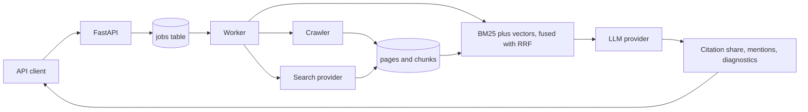

# AEO Simulator

Google SEO ranking for SmartCrew is the active track. The answer-engine simulation is parked. See `docs/accuracy.md`.

A sandbox search and answer engine for answer-engine optimization. You submit a site and the questions you want to win. The service indexes those pages, pulls a competitor set, expands each question into sub-queries, and writes several grounded answers. It then reports how often the submitted domain was cited or mentioned, why a page is losing, and how a draft or re-crawl changes that.

These are sandbox results. `answers_are_official_engine_results` is always `false`. The simulator does not pretend to be ChatGPT, Perplexity, or Google AI Overviews. Log what those products actually did on `POST /v1/calibration` if you want to measure whether the sandbox tracks them.

## Why Python

The core of this service is document processing and ranking: robots-aware fetching, HTML extraction, Okapi BM25, cosine similarity, and reciprocal rank fusion. Python's HTTP, parsing, and numeric libraries make that path short and testable. FastAPI turns the same types into the OpenAPI document at `/docs`. A TypeScript service would need extra libraries for BM25 and HTML extraction without making the scoring easier to verify.

## Architecture



1. **Index.** `POST /v1/simulations` accepts a site URL, an optional sitemap, or pasted HTML. A worker fetches raw HTML (no JavaScript unless Playwright is installed and `render_js` is true), respects `robots.txt`, and stores title, meta description, canonical, headings, main text, JSON-LD, links, and dates. Text is split into passages. SQLite stores them in FTS5. Postgres also stores a `tsvector` and a `pgvector` column.
2. **Competitors.** For each question the search provider returns top results. The Brave adapter (`BRAVE_API_KEY`) returns live URLs, which are fetched and indexed. The mock adapter returns synthetic HTML and labels it `synthetic: true`. If no provider is configured, the run does not invent a SERP.
3. **Fan-out.** The LLM expands the question into sub-queries. The original question is always kept. Each sub-query is retrieved with Okapi BM25 and cosine similarity, then the lists are fused with reciprocal rank fusion (`1 / (60 + rank)`). A second fusion step merges the sub-queries.
4. **Answers.** The LLM writes one grounded answer per run (default 5) using only the fused passages, cited as `[S1]`. Unknown markers are recorded and dropped. Citation share is the fraction of runs whose citations include the submitted domain. Mention rate is the fraction whose prose names the domain or its first label, outside the citation markers.
5. **Diagnostics.** Each question is labeled `likely_cited`, `missing_page`, `weak_page`, `crawl_index_issue`, or `third_parties_dominating`, plus raw-HTML checks: h1, title, meta description, canonical, text present in the raw document, word count, updated date, and an answer-first opening.
6. **A/B.** `POST /v1/questions/{id}/ab` snapshots the current runs, applies a pasted HTML draft or a re-crawl, runs the question again against the same sub-queries and competitor set, and returns the before/after diff.
7. **Calibration.** `POST /v1/calibration` stores an observation you made in a real engine. `GET /v1/calibration/accuracy` scores those rows against the citation share that was on the question at log time. With no rows, accuracy is `null`.

Ranking of a question's in-scope passages (the site plus that question's rivals) is done in process, so SQLite and Postgres produce the same order. The Postgres `embedding vector(N)` column and `tsvector` are written on index so a larger corpus can prefilter later. FTS5 is the SQLite full-text index; Okapi BM25, not the database rank function, is what the tests lock.

Jobs live in the `jobs` table. Postgres workers claim with `FOR UPDATE SKIP LOCKED`. Use one worker with SQLite. `PROCESS_JOBS_INLINE=true` runs jobs inside the API process; do not start a worker as well.

The crawler allows only `http` and `https`, refuses credentials, and blocks private, loopback, and link-local addresses unless `CRAWL_ALLOW_PRIVATE=true`. It also checks resolved addresses before connecting.

## Setup

```bash
python -m venv .venv
source .venv/bin/activate
pip install -e ".[dev]"
cp .env.example .env
pytest
python examples/run_local.py
```

The example runs in-process with the mock search, mock LLM, and hashing embedder. It indexes pasted HTML for `https://northwind.example` (nothing is fetched), asks one question the page answers and one it does not, then replaces the page with an off-topic draft and prints the diff.

API server, with a separate worker:

```bash
mkdir -p data
export DATABASE_URL=sqlite:///./data/aeo.db
export SEARCH_PROVIDER=mock LLM_PROVIDER=mock EMBEDDING_PROVIDER=mock
export PROCESS_JOBS_INLINE=false CRAWL_DELAY_SECONDS=0
uvicorn aeo.main:app --app-dir src --host 127.0.0.1 --port 8741
# second shell, same environment
python -m aeo.worker
python examples/run_local.py --base-url http://127.0.0.1:8741
```

Interactive docs: [http://127.0.0.1:8741/docs](http://127.0.0.1:8741/docs). The OpenAPI document is also committed as `openapi.json`.

### Docker Compose

Postgres with pgvector, the API, and a worker. Compose defaults to the mock providers so it does not call Brave or OpenAI unless you set the variables.

```bash
SEARCH_PROVIDER=mock LLM_PROVIDER=mock EMBEDDING_PROVIDER=mock docker compose up --build
```

The API listens on port `8741`. Postgres is published on `54329`.

To use live competitors and a real model, set `BRAVE_API_KEY`, `OPENAI_API_KEY`, `SEARCH_PROVIDER=brave`, `LLM_PROVIDER=openai`, and, for API embeddings, `EMBEDDING_PROVIDER=openai` plus `EMBEDDING_DIM` matching the model (`1536` for `text-embedding-3-small`). Mismatched dimensions fail the job instead of silently mixing vector spaces. Answers from that model are still sandbox answers over this retriever, not official ChatGPT, Perplexity, or Google AI Overview responses.

JavaScript rendering is optional. Install Playwright and Chromium yourself, then pass `"render_js": true`. If Playwright is missing, the job indexes raw HTML and says so. It does not invent a rendered DOM.

## Example

`python examples/run_local.py` prints a report like this (mocks only):

```text
answers_are_official_engine_results: False
providers: search=mock llm=mock embeddings=mock synthetic=True
compared_against_live_web: False

Q: What is the best trail mix for long hikes?
  diagnosis=likely_cited  citation_share=0.8  mention_rate=0.8  mean_position=1.0
  raw html: h1=True title=True meta=True canonical=True text_in_raw_html=True words=142 updated=True answer_first=True

Q: What is the capital of France?
  diagnosis=missing_page  citation_share=0.0  mention_rate=0.0

A/B draft that removes the trail-mix answer
  citation share 0.8 -> 0.0 (-0.8)
  diagnosis      likely_cited -> missing_page
  improved=False
```

The 0.8 share is the mock LLM's fixed variation: the top passage is cited on 4 of 5 runs. It is not a prediction sampled from a production answer engine. Competitor pages in this run are synthetic stubs, not live rankings.

A minimal create call:

```bash
curl -s -X POST http://127.0.0.1:8741/v1/simulations \
  -H 'content-type: application/json' \
  -d @- <<'JSON'
{
  "site_url": "https://northwind.example",
  "pages": [{
    "url": "https://northwind.example/trail-mix",
    "html": "<html><head><title>Best trail mix for long hikes | Northwind</title><meta name=\"description\" content=\"Salt and almonds for long hikes.\"><link rel=\"canonical\" href=\"https://northwind.example/trail-mix\"></head><body><h1>Best trail mix for long hikes</h1><p>The best trail mix for long hikes is almonds, pumpkin seeds, and salt. Northwind packs this trail mix for long hikes.</p></body></html>"
  }],
  "questions": ["What is the best trail mix for long hikes?"],
  "n_runs": 5,
  "search_provider": "mock",
  "llm_provider": "mock"
}
JSON
```

With `PROCESS_JOBS_INLINE=false`, poll `GET /v1/simulations/{id}` or `GET /v1/jobs/{job_id}` until `status` is `completed` or `failed`.

Record a real observation after you have checked an engine yourself:

```bash
curl -s -X POST http://127.0.0.1:8741/v1/calibration \
  -H 'content-type: application/json' \
  -d '{"engine":"chatgpt","question_id":"QUESTION_ID","cited":true,"mentioned":true,"citation_position":1,"notes":"Checked by hand."}'
curl -s http://127.0.0.1:8741/v1/calibration/accuracy
```

The stored `predicted_citation_share` is copied from the question at log time. Later re-runs do not rewrite it.

## API

| Method | Path | Purpose |
| --- | --- | --- |
| `GET` | `/health` | Process and database dialect |
| `GET` | `/v1/providers` | Resolved providers, key presence, mock warnings |
| `POST` | `/v1/simulations` | Index a site and run questions |
| `GET` | `/v1/simulations/{id}` | Status and full results |
| `POST` | `/v1/sites` | Index only |
| `GET` | `/v1/sites/{id}` | Indexed pages |
| `POST` | `/v1/sites/{id}/questions` | Run questions against an indexed site |
| `GET` | `/v1/pages/{id}` | Extracted page; `?include_html=true` adds raw HTML |
| `POST` | `/v1/questions/{id}/ab` | Draft or re-crawl, then diff |
| `GET` | `/v1/ab/{id}` | A/B status and diff |
| `POST` | `/v1/calibration` | Log a real engine observation |
| `GET` | `/v1/calibration/accuracy` | Accuracy, precision, recall, Brier score |
| `GET` | `/v1/jobs/{id}` | Queue job |
| `GET` | `/ranksim` | SmartCrew Google rank report (predicted only) |

`search_provider` is `auto`, `brave`, `mock`, or `none`. `llm_provider` and `embedding_provider` are `auto`, `openai`, or `mock`. `auto` uses the live adapter only when the matching API key is set. `brave` or `openai` without a key returns 400 and does not fall back to the mock.

## Configuration

See `.env.example`. The important switches are `DATABASE_URL`, `SEARCH_PROVIDER`, `BRAVE_API_KEY`, `LLM_PROVIDER`, `OPENAI_API_KEY`, `OPENAI_BASE_URL`, `OPENAI_MODEL`, `EMBEDDING_PROVIDER`, `EMBEDDING_DIM`, and `PROCESS_JOBS_INLINE`.

`OPENAI_BASE_URL` can point at any OpenAI-compatible chat and embeddings server.

## Tests

```bash
pytest
```

They cover Okapi BM25 (including a hand-checked `log(2)` score), reciprocal rank fusion, hybrid ordering, fan-out parsing, citation position and mention rate, the mock run-to-run variation, diagnostic branches, before/after diffs, calibration with an empty log and with known pairs, robots.txt, private-address blocking, the Brave and OpenAI request shapes, and an API run that recomputes citation share from the mock policy. Network is not required. Mock output is flagged `synthetic`.

## Google rank simulator (SmartCrew)

A separate loop for `www.smartcrewhq.com`. Stage 1 retrieves with BM25F over title, URL, H1, headings, body, and anchor text. Stage 2 is LambdaMART (LightGBM) using the features in `docs/accuracy.md`. Predicted positions are scores on our index. They are not live Google ranks. Default weights are a published-practice prior. They are replaced only when you train on a real position file.

The keyword file is `smartcrew/keywords.csv` (150 queries: intent, suggested target page, and whether that URL is in the sitemap snapshot from 2026-10-29). 113 queries map to a page that exists. 37 are page gaps. Regenerate with:

```bash
python -m aeo.ranksim keywords
python -m aeo.ranksim gaps
```

`keywords --refresh-sitemap` refetches `https://www.smartcrewhq.com/sitemap.xml` and rewrites the snapshot. It does not invent URLs.

### Keys

| Env | Use |
| --- | --- |
| `SERPAPI_KEY` | Google organic results via SerpAPI. Preferred. |
| `DATAFORSEO_LOGIN` and `DATAFORSEO_PASSWORD` | Google organic results via DataForSEO. Used when SerpAPI is unset. |
| `BRAVE_API_KEY` | Fallback web search. Positions are Brave order, not Google. |
| `RANKSIM_AUTHORITY=dataforseo` | Optional backlink rank on the same DataForSEO account. Off by default. |

If none of the SERP keys are set, `collect` and `track` exit with an error. They do not invent a Google top 10. `--mock` is explicit and every row is marked synthetic.

### Commands

```bash
python -m aeo.ranksim evaluate smartcrew/serp.csv
python -m aeo.ranksim train smartcrew/serp.csv
python -m aeo.ranksim test page.html --url https://www.smartcrewhq.com/dirtwork-software/
python -m aeo.ranksim test https://www.smartcrewhq.com/dirtwork-software/
python -m aeo.ranksim report
```

`evaluate` and `train` read `query,url,position` or a Search Console export with Query, Page, and Position. Optional `prior_position` is an older Google observation used as a Navboost stand-in. If that column copies `position`, it is withheld so the metric cannot cheat. With fewer than two usable queries, the command prints what file is needed and does not emit NDCG, Spearman, top-3 hit rate, or pairwise accuracy.

`test` re-fetches only the page you pass (or reads a local file). It prints predicted position before and after, the competitor gaps, and which features moved. A blank before-position means the page was outside the stored set, not a rank of 151.

`test` re-fetches only the page you pass (or reads a local file). Competitors stay as stored. It prints predicted position before and after for every query, plus heading terms, tables, or FAQ blocks the stored competitors have that the new page lacks. A blank before-position means SmartCrew was outside the fetched results, not a rank of 151.

Daily check, once a SERP key is set:

```bash
0 6 * * * cd /path/to/repo && python -m aeo.ranksim track
```

The tracker appends a row per query. It does not fill days you did not run.

The HTML report is [http://127.0.0.1:8741/ranksim](http://127.0.0.1:8741/ranksim) and `smartcrew/report.html`. With an empty corpus it lists page gaps and says calibration has not been run. It does not print a Spearman number until a SERP has been stored.

On a 3-page labeled mock in the unit tests, the fitter reaches Spearman 1 and NDCG at 10 of 1. That only shows the math can recover an obvious order. It is not Google accuracy. No Google calibration has been run in this environment because no SerpAPI or DataForSEO key is configured.

## What's next

- A real report UI on top of these endpoints.
- Playwright in the default image, and a clearer split between "cited in the rendered-index simulation" and "visible in raw HTML".
- HNSW on the pgvector column once a question's corpus is too large to score in memory. The fusion code can keep using the same scores.
- More search adapters behind the same `SearchProvider` interface.
- Retries for failed fetches, and more than one SQLite-safe worker by moving the dev queue fully onto Postgres.
- Auth and a per-tenant crawl allowlist before this is exposed beyond a local sandbox.
- Prompt and threshold changes driven by the calibration log, once that log has real observations. The log starts empty on purpose.
