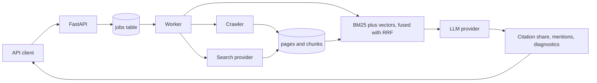

# Ranksim

# AEO Simulator

Google SEO ranking for SmartCrew is the active track. The answer-engine simulation is parked. See `docs/accuracy.md`.

A sandbox search and answer engine for answer-engine optimization. You submit a site and the questions you want to win. The service indexes those pages, pulls a competitor set, expands each question into sub-queries, and writes several grounded answers. It then reports how often the submitted domain was cited or mentioned, why a page is losing, and how a draft or re-crawl changes that.

These are sandbox results. `answers_are_official_engine_results` is always `false`. The simulator does not pretend to be ChatGPT, Perplexity, or Google AI Overviews. Log what those products actually did on `POST /v1/calibration` if you want to measure whether the sandbox tracks them.

## Why Python

The core of this service is document processing and ranking: robots-aware fetching, HTML extraction, Okapi BM25, cosine similarity, and reciprocal rank fusion. Python's HTTP, parsing, and numeric libraries make that path short and testable. FastAPI turns the same types into the OpenAPI document at `/docs`. A TypeScript service would need extra libraries for BM25 and HTML extraction without making the scoring easier to verify.

## Architecture



1. **Index.** `POST /v1/simulations` accepts a site URL, an optional sitemap, or pasted HTML. A worker fetches raw HTML (no JavaScript unless Playwright is installed and `render_js` is true), respects `robots.txt`, and stores title, meta description, canonical, headings, main text, JSON-LD, links, and dates. Text is split into passages. SQLite stores them in FTS5. Postgres also stores a `tsvector` and a `pgvector` column.
2. **Competitors.** For each question the search provider returns top results. The Brave adapter (`BRAVE_API_KEY`) returns live URLs, which are fetched and indexed. The mock adapter returns synthetic HTML and labels it `synthetic: true`. If no provider is configured, the run does not invent a SERP.
3. **Fan-out.** The LLM expands the question into sub-queries. The original question is always kept. Each sub-query is retrieved with Okapi BM25 and cosine similarity, then the lists are fused with reciprocal rank fusion (`1 / (60 + rank)`). A second fusion step merges the sub-queries.
4. **Answers.** The LLM writes one grounded answer per run (default 5) using only the fused passages, cited as `[S1]`. Unknown markers are recorded and dropped. Citation share is the fraction of runs whose citations include the submitted domain. Mention rate is the fraction whose prose names the domain or its first label, outside the citation markers.
5. **Diagnostics.** Each question is labeled `likely_cited`, `missing_page`, `weak_page`, `crawl_index_issue`, or `third_parties_dominating`, plus raw-HTML checks: h1, title, meta description, canonical, text present in the raw document, word count, updated date, and an answer-first opening.
6. **A/B.** `POST /v1/questions/{id}/ab` snapshots the current runs, applies a pasted HTML draft or a re-crawl, runs the question again against the same sub-queries and competitor set, and returns the before/after diff.
7. **Calibration.** `POST /v1/calibration` stores an observation you made in a real engine. `GET /v1/calibration/accuracy` scores those rows against the citation share that was on the question at log time. With no rows, accuracy is `null`.

Ranking of a question's in-scope passages (the site plus that question's rivals) is done in process, so SQLite and Postgres produce the same order. The Postgres `embedding vector(N)` column and `tsvector` are written on index so a larger corpus can prefilter later. FTS5 is the SQLite full-text index; Okapi BM25, not the database rank function, is what the tests lock.

Jobs live in the `jobs` table. Postgres workers claim with `FOR UPDATE SKIP LOCKED`. Use one worker with SQLite. `PROCESS_JOBS_INLINE=true` runs jobs inside the API process; do not start a worker as well.

The crawler allows only `http` and `https`, refuses credentials, and blocks private, loopback, and link-local addresses unless `CRAWL_ALLOW_PRIVATE=true`. It also checks resolved addresses before connecting.

## Setup

```bash
python -m venv .venv
source .venv/bin/activate
pip install -e ".[dev]"
cp .env.example .env
pytest
python examples/run_local.py
```

The example runs in-process with the mock search, mock LLM, and hashing embedder. It indexes pasted HTML for `https://northwind.example` (nothing is fetched), asks one question the page answers and one it does not, then replaces the page with an off-topic draft and prints the diff.

API server, with a separate worker:

```bash
mkdir -p data
export DATABASE_URL=sqlite:///./data/aeo.db
export SEARCH_PROVIDER=mock LLM_PROVIDER=mock EMBEDDING_PROVIDER=mock
export PROCESS_JOBS_INLINE=false CRAWL_DELAY_SECONDS=0
uvicorn aeo.main:app --app-dir src --host 127.0.0.1 --port 8741
# second shell, same environment
python -m aeo.worker
python examples/run_local.py --base-url http://127.0.0.1:8741
```

Interactive docs: [http://127.0.0.1:8741/docs](http://127.0.0.1:8741/docs). The OpenAPI document is also committed as `openapi.json`.

### Docker Compose

Postgres with pgvector, the API, and a worker. Compose defaults to the mock providers so it does not call Brave or OpenAI unless you set the variables.

```bash
SEARCH_PROVIDER=mock LLM_PROVIDER=mock EMBEDDING_PROVIDER=mock docker compose up --build
```

The API listens on port `8741`. Postgres is published on `54329`.

To use live competitors and a real model, set `BRAVE_API_KEY`, `OPENAI_API_KEY`, `SEARCH_PROVIDER=brave`, `LLM_PROVIDER=openai`, and, for API embeddings, `EMBEDDING_PROVIDER=openai` plus `EMBEDDING_DIM` matching the model (`1536` for `text-embedding-3-small`). Mismatched dimensions fail the job instead of silently mixing vector spaces. Answers from that model are still sandbox answers over this retriever, not official ChatGPT, Perplexity, or Google AI Overview responses.

JavaScript rendering is optional. Install Playwright and Chromium yourself, then pass `"render_js": true`. If Playwright is missing, the job indexes raw HTML and says so. It does not invent a rendered DOM.

## Example

`python examples/run_local.py` prints a report like this (mocks only):

```text
answers_are_official_engine_results: False
providers: search=mock llm=mock embeddings=mock synthetic=True
compared_against_live_web: False

Q: What is the best trail mix for long hikes?
  diagnosis=likely_cited  citation_share=0.8  mention_rate=0.8  mean_position=1.0
  raw html: h1=True title=True meta=True canonical=True text_in_raw_html=True words=142 updated=True answer_first=True

Q: What is the capital of France?
  diagnosis=missing_page  citation_share=0.0  mention_rate=0.0

A/B draft that removes the trail-mix answer
  citation share 0.8 -> 0.0 (-0.8)
  diagnosis      likely_cited -> missing_page
  improved=False
```

The 0.8 share is the mock LLM's fixed variation: the top passage is cited on 4 of 5 runs. It is not a prediction sampled from a production answer engine. Competitor pages in this run are synthetic stubs, not live rankings.

A minimal create call:

```bash
curl -s -X POST http://127.0.0.1:8741/v1/simulations \
  -H 'content-type: application/json' \
  -d @- <<'JSON'
{
  "site_url": "https://northwind.example",
  "pages": [{
    "url": "https://northwind.example/trail-mix",
    "html": "<html><head><title>Best trail mix for long hikes | Northwind</title><meta name=\"description\" content=\"Salt and almonds for long hikes.\"><link rel=\"canonical\" href=\"https://northwind.example/trail-mix\"></head><body><h1>Best trail mix for long hikes</h1><p>The best trail mix for long hikes is almonds, pumpkin seeds, and salt. Northwind packs this trail mix for long hikes.</p></body></html>"
  }],
  "questions": ["What is the best trail mix for long hikes?"],
  "n_runs": 5,
  "search_provider": "mock",
  "llm_provider": "mock"
}
JSON
```

With `PROCESS_JOBS_INLINE=false`, poll `GET /v1/simulations/{id}` or `GET /v1/jobs/{job_id}` until `status` is `completed` or `failed`.

Record a real observation after you have checked an engine yourself:

```bash
curl -s -X POST http://127.0.0.1:8741/v1/calibration \
  -H 'content-type: application/json' \
  -d '{"engine":"chatgpt","question_id":"QUESTION_ID","cited":true,"mentioned":true,"citation_position":1,"notes":"Checked by hand."}'
curl -s http://127.0.0.1:8741/v1/calibration/accuracy
```

The stored `predicted_citation_share` is copied from the question at log time. Later re-runs do not rewrite it.

## API

| Method | Path | Purpose |
| --- | --- | --- |
| `GET` | `/health` | Process and database dialect |
| `GET` | `/v1/providers` | Resolved providers, key presence, mock warnings |
| `POST` | `/v1/simulations` | Index a site and run questions |
| `GET` | `/v1/simulations/{id}` | Status and full results |
| `POST` | `/v1/sites` | Index only |
| `GET` | `/v1/sites/{id}` | Indexed pages |
| `POST` | `/v1/sites/{id}/questions` | Run questions against an indexed site |
| `GET` | `/v1/pages/{id}` | Extracted page; `?include_html=true` adds raw HTML |
| `POST` | `/v1/questions/{id}/ab` | Draft or re-crawl, then diff |
| `GET` | `/v1/ab/{id}` | A/B status and diff |
| `POST` | `/v1/calibration` | Log a real engine observation |
| `GET` | `/v1/calibration/accuracy` | Accuracy, precision, recall, Brier score |
| `GET` | `/v1/jobs/{id}` | Queue job |
| `GET` | `/ranksim` | SmartCrew Google rank report (predicted only) |

`search_provider` is `auto`, `brave`, `mock`, or `none`. `llm_provider` and `embedding_provider` are `auto`, `openai`, or `mock`. `auto` uses the live adapter only when the matching API key is set. `brave` or `openai` without a key returns 400 and does not fall back to the mock.

## Configuration

See `.env.example`. The important switches are `DATABASE_URL`, `SEARCH_PROVIDER`, `BRAVE_API_KEY`, `LLM_PROVIDER`, `OPENAI_API_KEY`, `OPENAI_BASE_URL`, `OPENAI_MODEL`, `EMBEDDING_PROVIDER`, `EMBEDDING_DIM`, and `PROCESS_JOBS_INLINE`.

`OPENAI_BASE_URL` can point at any OpenAI-compatible chat and embeddings server.

## Tests

```bash
pytest
```

They cover Okapi BM25 (including a hand-checked `log(2)` score), reciprocal rank fusion, hybrid ordering, fan-out parsing, citation position and mention rate, the mock run-to-run variation, diagnostic branches, before/after diffs, calibration with an empty log and with known pairs, robots.txt, private-address blocking, the Brave and OpenAI request shapes, and an API run that recomputes citation share from the mock policy. Network is not required. Mock output is flagged `synthetic`.

## Google rank simulator (SmartCrew)

Run it locally:

```bash
pip install -e ".[dev]"
python -m aeo.ranksim serve
```

Then open http://127.0.0.1:8765/ . The first start, on an empty database, loads the committed HTML in `smartcrew/saved_html` and `smartcrew/pr8_v3`. It does not crawl and it does not invent the pages that are not in those files.

The AI eval, after you export a key:

```bash
export OPENROUTER_API_KEY="your-key"
bash scripts/ai_eval.sh
```

`OPENAI_API_KEY` is used for OpenRouter when the key starts with `sk-or-`. Otherwise a normal OpenAI key uses `gpt-4o-mini`, and `ANTHROPIC_API_KEY` uses `claude-3-5-haiku-20241022`. Set `RANKSIM_LLM_MODEL` to override. OpenRouter's default model is `openai/gpt-4o-mini`. Calls are cached in `data/llm-cache/` and the estimated cost is appended to `data/llm-cost.jsonl`.

A separate loop for `www.smartcrewhq.com`. Stage 1 retrieves with BM25F over title, URL, H1, headings, body, and anchor text. Stage 2 is LambdaMART (LightGBM) using the features in `docs/accuracy.md`. Predicted positions are scores on our index. They are not live Google ranks. Default weights are a published-practice prior. They are replaced only when you train on a real position file.

The keyword file is `smartcrew/keywords.csv` (150 queries: intent, suggested target page, and whether that URL is in the sitemap snapshot from 2026-10-29). 113 queries map to a page that exists. 37 are page gaps. Regenerate with:

```bash
python -m aeo.ranksim keywords
python -m aeo.ranksim gaps
```

`keywords --refresh-sitemap` refetches `https://www.smartcrewhq.com/sitemap.xml` and rewrites the snapshot. It does not invent URLs.

### Projects: test a page on all your key searches

This is the main product. A project is your site plus the searches that matter to you. A pull records the REAL Google top 10 for every search, stores every result page in the shared rank database (`data/ranksim.db`, reused across projects), and trains a mini search engine on that set. Then you test a page, as a local file or a preview URL, and see where it would slot in on every search in seconds instead of waiting for Google to index it.

```bash
# 1. Create the project.
python -m aeo.ranksim project create SmartCrew --site www.smartcrewhq.com --searches "all in one dirt work software; hcss heavyjob alternative"

# 2a. Pull the REAL Google top 10 now. Needs SERPAPI_KEY, SERPER_API_KEY, or DATAFORSEO_LOGIN and DATAFORSEO_PASSWORD.
python -m aeo.ranksim project pull smartcrew

# 2b. Or seed REAL results you already have (query,url,position), then crawl and train without calling Google.
python -m aeo.ranksim project import-serp smartcrew smartcrew/serp.csv --add-searches
python -m aeo.ranksim project pull smartcrew --skip-google

# 3. Test a page. Every search, every time. --json for a UI or CI, --fail-on-regression to block a worse version.
python -m aeo.ranksim project test smartcrew draft.html --url https://www.smartcrewhq.com/all-in-one-dirt-work-software/

python -m aeo.ranksim project show smartcrew
python -m aeo.ranksim project list
python -m aeo.ranksim project searches smartcrew --add "dirt work software" --remove "b2w alternative"
```

**What is REAL and what is PREDICTED.** The Google results are REAL and always carry their source and pull time. `smartcrew/serp.csv` is labeled `smartcrew/serp.csv (committed 2026-10-29, pull date not recorded)`. Pass `--snapshot-date YYYY-MM-DD` to `import-serp` when you know the day. Where your page slots in is PREDICTED. The incumbents keep their REAL order and the model only decides where your page goes: by default the slot is 1 plus the number of stored incumbents the model scores above you (`insertion_position` in `src/aeo/ranksim/project.py`, pluggable). REAL results with no stored HTML are listed, not scored, so the board also shows the range from none of them beating you to all of them beating you. With no Google key and no imported results, `pull` stops and names the env vars. A search with no REAL results shows `not run: needs SERPAPI_KEY, SERPER_API_KEY, or DATAFORSEO_LOGIN and DATAFORSEO_PASSWORD`. Nothing is invented.

**Reading the project board.** The summary line reads `PREDICTED top 3 on X of N searches, top 10 on Y of N. REAL today (pull date): top 10 on Z of N.` Then one row per search: the PREDICTED slot, its range, this URL's REAL position, the change against the stored copy of the URL and against the previous version (both rescored now on the same engine), UNSURE or CLEARER, the independent linear check, and how many REAL results are stored (THIN under half). Under each search: the REAL top 10 with your page marked where it slots in, the stored pages PREDICTED to beat you, and for the closest ones what you can change on the page (model features, your value and theirs) apart from the site signals an edit does not change (domain, link signals). When the URL already ranks, a check line compares the stored copy's PREDICTED slot with its REAL position, which shows how far off the model is on that search. The backtest line says how much to trust any of it: on the SmartCrew file it is pairwise 0.528, barely better than a coin flip.

**Pulls.** `pull` runs four timed steps: google, crawl, train, save. The crawl fetches every result URL and your own pages (results on your domain, pages already stored for it, `--sitemap-file` or `/sitemap.xml`) that are not stored or are older than `--fresh-days` (7). It runs hosts in parallel, respects robots.txt, refuses private addresses, and records a status per URL: stored, fetched now, blocked by robots, HTTP 403, or error. A failed refresh never erases a stored copy. Each pull is saved in `data/projects/<slug>/pulls/<UTC timestamp>/` as `google.json`, `pull.json` (statuses, step timings, backtest), and `engine/`, so `project test` loads in under a second. Tested versions go to `data/projects/<slug>/tests/`.

**Measured in this checkout** (16 searches, 139 URLs, pages already stored): create 0.6 s, import 0.6 s, pull with `--skip-google` 9.9 s (crawl 1.2 s for the 5 pages that were not stored, train 7.8 s), engine load 0.4 s, `project test` 2.0 s wall for all 16 searches. A cold pull into an empty database, fetching all 137 pages, took 37.7 s (crawl 29.6 s, train 7.2 s). On that cold crawl 12 Reddit and Facebook results were blocked by robots.txt and 7 returned HTTP errors, so 30 REAL results had no stored HTML.

### Sandbox tester and optimize loop

`tester` puts one version of a page into the stored competitor set and scores it on its target queries in under a second, after a few seconds of model loading. You edit the page, the tester re-indexes and re-scores it, and you see which version does better before anything is published. `optimize` is the rapid iteration version: it rewrites the page, scores each version, and keeps the best one until every target query is PREDICTED at `--goal` or better, or a stop rule ends the run.

```bash
# A local draft. --url is the page the draft will replace.
python -m aeo.ranksim tester draft.html --url https://www.smartcrewhq.com/compare/hcss-heavyjob-alternative/

# A preview or staging deploy, scored as the canonical page.
python -m aeo.ranksim tester https://preview.example.com/compare/hcss-heavyjob-alternative/ --url https://www.smartcrewhq.com/compare/hcss-heavyjob-alternative/

# Watch a file or a preview URL. A new board prints only when the HTML changes.
python -m aeo.ranksim tester draft.html --url https://www.smartcrewhq.com/compare/hcss-heavyjob-alternative/ --watch --interval 15

# CI. JSON on stdout. Exit 1 when a target query is PREDICTED worse.
python -m aeo.ranksim tester draft.html --url https://www.smartcrewhq.com/compare/hcss-heavyjob-alternative/ --queries "hcss alternative,hcss heavyjob alternative" --json --fail-on-regression

# Optimize offline. The rules rewriter is not an LLM.
python -m aeo.ranksim optimize draft.html --url https://www.smartcrewhq.com/all-in-one-heavy-civil-software/ --rewriter rules --goal 1

# Optimize with the LLM rewriter. It needs an LLM key.
export OPENROUTER_API_KEY="your-key"
python -m aeo.ranksim optimize draft.html --url https://www.smartcrewhq.com/all-in-one-heavy-civil-software/ --rewriter llm --goal 3 --budget-usd 0.50
```

A URL source is fetched by the crawler, so `robots.txt` is respected and private addresses are blocked. Set `CRAWL_ALLOW_PRIVATE=true` for a preview on localhost. `--watch` polls every `--interval` seconds (15 by default) until Ctrl+C, or for `--max-checks` polls. With `--json` and `--watch` it prints one JSON document per line. `--fail-on-regression` exits 1 when a target query is PREDICTED worse than the stored copy of the URL, or than v1 when none is stored. In this checkout, model load took 2.4 s and scoring took 42 to 196 ms for two queries.

**Reading the tester board.** Each row is one target query. `3/9` means PREDICTED 3 of the 9 pages scored. The `live` column scores the HTML the rank database holds for this URL. It is headed `stored` when that HTML was seeded from a committed file such as `smartcrew/pr8_v3`, because it is not the live site. `prev` is the version before this one and `now` is this version. `change` and `flag` compare `now` with the `live` or `stored` column, or with v1 when the database holds no copy of the URL: `better`, `same`, or `WORSE`, and `n/a` before there is anything to compare. `confidence` is UNSURE or CLEARER. `linear` is an independent hand-weighted scorer on the same pages. When it disagrees with the model, treat the move as unproven. `stored set` counts the labeled Google results for the query that have stored HTML. THIN means fewer than half, and a rank on that set says little. `biggest gap` is the largest gap to the pages PREDICTED ahead, written as a fix. Below the table the board lists the pages PREDICTED ahead, this URL's position in the labeled Google file (a past snapshot, not a live rank), and the skipped queries, which get no rank. Target queries come from the labeled Google file: rows for this URL first, then `keywords.csv` targets, then title, H1, and URL overlap. Once v1 or a stored copy exists, its queries stay pinned, so an edit cannot drop a query from the check. Each changed version is saved as v1, v2, and so on in `data/tester/<url hash>.jsonl`.

**Reading an optimize run.** Each round prints accepted or rejected with the reason. Then come a start vs best table, the stop reason, and what changed. A version is kept only when it passes the guards, improves the PREDICTED objective, makes no target query worse, and the linear check does not get worse. The guards reject keyword stuffing (term share and exact-phrase rate over the whole body, over the first 8000 characters the model reads, and over every run of 200 words), repeated blocks and headings, headings inside nav, footer, or form, new hidden text with a query term (off-screen, tiny, transparent, or CSS-hidden), link farms and empty anchors, a body that shrinks, a page without exactly one title and one H1, and new numbers, prices, ratings, review markup, or model instructions that the starting page does not have. Last place in a stored set never counts as reaching the goal. The best version is kept, not the last. `--rewriter rules` edits the title and the H1 once each, adds one H2 and a visible updated date, never adds body copy, and never writes best or top into a title or H1. The LLM rewriter sees the title and the opening of the page around the H1, at most 12000 characters, and its reply replaces only that opening. `auto` and `llm` exit 2 without an LLM key. `--budget-usd` stops before a call that would likely pass the budget, and stops when the model has no published rate. Output goes to `data/optimize/<slug>/`: `best.html`, `round-NN.html`, `log.json`, and `report.txt`. When no round was accepted, the report says there is nothing new to publish.

**What it does not tell you.** Every rank in both commands is PREDICTED by the leave-one-query-out models on the stored pages. None of it is a live Google rank, and reaching the goal is a sandbox result, not a Google result. Both commands print the backtest for the pages stored now. In this checkout it was pairwise 0.485 on 12 queries, no better than a coin flip, so a PREDICTED move is a smoke test. Review `best.html` for accuracy, publish it, then run `track` to record the real rank. Only the tracked rank says what Google did.

### Keys

| Env | Use |
| --- | --- |
| `SERPAPI_KEY` | Google organic results via SerpAPI. Preferred. |
| `DATAFORSEO_LOGIN` and `DATAFORSEO_PASSWORD` | Google organic results via DataForSEO. Used when SerpAPI is unset. |
| `SERPER_API_KEY` | Google organic results via Serper. Used when SerpAPI and DataForSEO are unset. |
| `BRAVE_API_KEY` | Fallback web search. Positions are Brave order, not Google. |
| `OPENROUTER_API_KEY` | Cheap AI layer via OpenRouter (`openai/gpt-4o-mini` by default). |
| `OPENAI_API_KEY` | OpenAI, or OpenRouter when the key starts with `sk-or-`. |
| `ANTHROPIC_API_KEY` | Anthropic Haiku when no OpenRouter or OpenAI key is set. |
| `RANKSIM_LLM_MODEL` | Optional model override. |
| `RANKSIM_AUTHORITY=dataforseo` | Optional backlink rank on the same DataForSEO account. Off by default. |

If none of the SERP keys are set, `collect` and `track` exit with an error. They do not invent a Google top 10. `--mock` is explicit and every row is marked synthetic.

### Commands

```bash
python -m aeo.ranksim evaluate smartcrew/serp.csv
python -m aeo.ranksim train smartcrew/serp.csv
python -m aeo.ranksim test page.html --url https://www.smartcrewhq.com/dirtwork-software/
python -m aeo.ranksim test https://www.smartcrewhq.com/dirtwork-software/
python -m aeo.ranksim test --bundle smartcrew/pr8/manifest.csv --serp smartcrew/serp.csv
python -m aeo.ranksim test --three-way smartcrew/pr8/manifest.csv smartcrew/pr8_v2/manifest.csv --serp smartcrew/serp.csv
python -m aeo.ranksim test --regression smartcrew/pr8_v2/manifest.csv smartcrew/pr8_v3/manifest.csv --serp smartcrew/serp.csv
python -m aeo.ranksim graph --serp smartcrew/serp.csv
python -m aeo.ranksim graph-eval
python -m aeo.ranksim noise day-one.csv day-two.csv
python -m aeo.ranksim serve --port 8765
python -m aeo.ranksim competitors import --from-serps --crawl
python -m aeo.ranksim space
python -m aeo.ranksim report
python -m aeo.ranksim tester page.html --url https://www.smartcrewhq.com/compare/hcss-heavyjob-alternative/
python -m aeo.ranksim optimize page.html --url https://www.smartcrewhq.com/all-in-one-heavy-civil-software/ --rewriter rules
```

`evaluate` and `train` default to leave-one-query-out. They read `query,url,position` or a Search Console export with Query, Page, and Position. Optional `prior_position` is an older Google observation used as a Navboost stand-in. If that column copies `position`, it is withheld so the metric cannot cheat. With fewer than two usable queries, the command prints what file is needed and does not emit NDCG, Spearman, top-3 hit rate, or pairwise accuracy.

Blocked pages can be added later without a refetch. Put the HTML in `smartcrew/saved_html/` and list `url,file` in `manifest.csv`. A missing file is skipped. No page text is invented.

`test` with one source re-fetches that page, or reads a local file, and rescores with the linear weights. Competitors stay as stored. A blank before-position means SmartCrew was outside the stored results, not a rank of 151.

`test --bundle` reads a `manifest.csv` of built HTML (`url,file`, files next to the manifest) and rescores every query in the labeled file with leave-one-query-out LambdaMART. Matching URLs replace stored HTML. URLs that were not in that query are added only on the after side. The report says predicted, names feature contribution changes, and lists Google top-3 URLs that were never crawled instead of inventing their text.

Daily check, once a SERP key is set:

```bash
0 6 * * * cd /path/to/repo && python -m aeo.ranksim track
```

The tracker appends a row per query. It does not fill days you did not run.

The HTML report is [http://127.0.0.1:8741/ranksim](http://127.0.0.1:8741/ranksim) and `smartcrew/report.html`.

`smartcrew/serp.csv` is a 16-query Google US export from 2026-10-29 (135 rows). `index-serp` crawls those URLs and, when `smartcrew/saved_html/manifest.csv` has a file, stores that HTML instead. Leave-one-query-out accuracy on the stored pages, after missing heading and body matches, monotone match features, and the 150-word gate: pairwise accuracy 0.534, NDCG at 10 of 0.695, Spearman 0.075, top-3 hit rate 0.500, on 122 labeled rows and 414 pairs. Thirteen labeled rows are still uncovered. The previous fit, before those constraints, had pairwise accuracy 0.604. Do not treat either figure as a stable measure of Google accuracy. A later polite recrawl stored fewer pages (41 labeled rows still uncovered). On that smaller set, pairwise accuracy is 0.592 without link-graph features and 0.604 with them. The +0.012 delta is not a meaningful gain, and it is not comparable to the 0.534 above.

## What's next

- A real report UI on top of these endpoints.
- Playwright in the default image, and a clearer split between "cited in the rendered-index simulation" and "visible in raw HTML".
- HNSW on the pgvector column once a question's corpus is too large to score in memory. The fusion code can keep using the same scores.
- More search adapters behind the same `SearchProvider` interface.
- Retries for failed fetches, and more than one SQLite-safe worker by moving the dev queue fully onto Postgres.
- Auth and a per-tenant crawl allowlist before this is exposed beyond a local sandbox.
- Prompt and threshold changes driven by the calibration log, once that log has real observations. The log starts empty on purpose.
