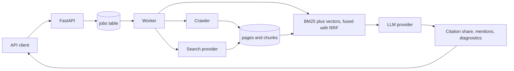

# Ranksim

# AEO Simulator

Google SEO ranking for SmartCrew is the active track. The answer-engine simulation is parked. See `docs/accuracy.md`.

A sandbox search and answer engine for answer-engine optimization. You submit a site and the questions you want to win. The service indexes those pages, pulls a competitor set, expands each question into sub-queries, and writes several grounded answers. It then reports how often the submitted domain was cited or mentioned, why a page is losing, and how a draft or re-crawl changes that.

These are sandbox results. `answers_are_official_engine_results` is always `false`. The simulator does not pretend to be ChatGPT, Perplexity, or Google AI Overviews. Log what those products actually did on `POST /v1/calibration` if you want to measure whether the sandbox tracks them.

## Why Python

The core of this service is document processing and ranking: robots-aware fetching, HTML extraction, Okapi BM25, cosine similarity, and reciprocal rank fusion. Python's HTTP, parsing, and numeric libraries make that path short and testable. FastAPI turns the same types into the OpenAPI document at `/docs`. A TypeScript service would need extra libraries for BM25 and HTML extraction without making the scoring easier to verify.

## Architecture



1. **Index.** `POST /v1/simulations` accepts a site URL, an optional sitemap, or pasted HTML. A worker fetches raw HTML (no JavaScript unless Playwright is installed and `render_js` is true), respects `robots.txt`, and stores title, meta description, canonical, headings, main text, JSON-LD, links, and dates. Text is split into passages. SQLite stores them in FTS5. Postgres also stores a `tsvector` and a `pgvector` column.
2. **Competitors.** For each question the search provider returns top results. The Brave adapter (`BRAVE_API_KEY`) returns live URLs, which are fetched and indexed. The mock adapter returns synthetic HTML and labels it `synthetic: true`. If no provider is configured, the run does not invent a SERP.
3. **Fan-out.** The LLM expands the question into sub-queries. The original question is always kept. Each sub-query is retrieved with Okapi BM25 and cosine similarity, then the lists are fused with reciprocal rank fusion (`1 / (60 + rank)`). A second fusion step merges the sub-queries.
4. **Answers.** The LLM writes one grounded answer per run (default 5) using only the fused passages, cited as `[S1]`. Unknown markers are recorded and dropped. Citation share is the fraction of runs whose citations include the submitted domain. Mention rate is the fraction whose prose names the domain or its first label, outside the citation markers.
5. **Diagnostics.** Each question is labeled `likely_cited`, `missing_page`, `weak_page`, `crawl_index_issue`, or `third_parties_dominating`, plus raw-HTML checks: h1, title, meta description, canonical, text present in the raw document, word count, updated date, and an answer-first opening.
6. **A/B.** `POST /v1/questions/{id}/ab` snapshots the current runs, applies a pasted HTML draft or a re-crawl, runs the question again against the same sub-queries and competitor set, and returns the before/after diff.
7. **Calibration.** `POST /v1/calibration` stores an observation you made in a real engine. `GET /v1/calibration/accuracy` scores those rows against the citation share that was on the question at log time. With no rows, accuracy is `null`.

Ranking of a question's in-scope passages (the site plus that question's rivals) is done in process, so SQLite and Postgres produce the same order. The Postgres `embedding vector(N)` column and `tsvector` are written on index so a larger corpus can prefilter later. FTS5 is the SQLite full-text index; Okapi BM25, not the database rank function, is what the tests lock.

Jobs live in the `jobs` table. Postgres workers claim with `FOR UPDATE SKIP LOCKED`. Use one worker with SQLite. `PROCESS_JOBS_INLINE=true` runs jobs inside the API process; do not start a worker as well.

The crawler allows only `http` and `https`, refuses credentials, and blocks private, loopback, and link-local addresses unless `CRAWL_ALLOW_PRIVATE=true`. It also checks resolved addresses before connecting.

Before the crawler fetches any public site, including the site you submit and live competitors, set `CRAWL_USER_AGENT` to your crawler's name and a contact site owners can reach. The example.com default is refused: the crawl job fails with an error that names `CRAWL_USER_AGENT`. `CRAWL_ALLOW_PRIVATE=true` turns this check off for local labs, so set a real contact before you use it with public sites.

## Setup

```bash
python -m venv .venv
source .venv/bin/activate
pip install -e ".[dev]"
cp .env.example .env
pytest
python examples/run_local.py
```

The example runs in-process with the mock search, mock LLM, and hashing embedder. It indexes pasted HTML for `https://northwind.example` (nothing is fetched), asks one question the page answers and one it does not, then replaces the page with an off-topic draft and prints the diff.

API server, with a separate worker:

```bash
mkdir -p data
export DATABASE_URL=sqlite:///./data/aeo.db
export SEARCH_PROVIDER=mock LLM_PROVIDER=mock EMBEDDING_PROVIDER=mock
export PROCESS_JOBS_INLINE=false CRAWL_DELAY_SECONDS=0
uvicorn aeo.main:app --app-dir src --host 127.0.0.1 --port 8741
# second shell, same environment
python -m aeo.worker
python examples/run_local.py --base-url http://127.0.0.1:8741
```

Interactive docs: [http://127.0.0.1:8741/docs](http://127.0.0.1:8741/docs). The OpenAPI document is also committed as `openapi.json`.

### Docker Compose

Postgres with pgvector, the API, and a worker. Compose defaults to the mock providers so it does not call Brave or OpenAI unless you set the variables.

```bash
SEARCH_PROVIDER=mock LLM_PROVIDER=mock EMBEDDING_PROVIDER=mock docker compose up --build
```

The API listens on port `8741`. Postgres is published on `54329`.

To use live competitors and a real model, set `BRAVE_API_KEY`, `OPENAI_API_KEY`, `SEARCH_PROVIDER=brave`, `LLM_PROVIDER=openai`, and, for API embeddings, `EMBEDDING_PROVIDER=openai` plus `EMBEDDING_DIM` matching the model (`1536` for `text-embedding-3-small`). Mismatched dimensions fail the job instead of silently mixing vector spaces. Answers from that model are still sandbox answers over this retriever, not official ChatGPT, Perplexity, or Google AI Overview responses.

JavaScript rendering is optional. Install Playwright and Chromium yourself, then pass `"render_js": true`. If Playwright is missing, the job indexes raw HTML and says so. It does not invent a rendered DOM.

## Example

`python examples/run_local.py` prints a report like this (mocks only):

```text
answers_are_official_engine_results: False
providers: search=mock llm=mock embeddings=mock synthetic=True
compared_against_live_web: False

Q: What is the best trail mix for long hikes?
  diagnosis=likely_cited  citation_share=0.8  mention_rate=0.8  mean_position=1.0
  raw html: h1=True title=True meta=True canonical=True text_in_raw_html=True words=142 updated=True answer_first=True

Q: What is the capital of France?
  diagnosis=missing_page  citation_share=0.0  mention_rate=0.0

A/B draft that removes the trail-mix answer
  citation share 0.8 -> 0.0 (-0.8)
  diagnosis      likely_cited -> missing_page
  improved=False
```

The 0.8 share is the mock LLM's fixed variation: the top passage is cited on 4 of 5 runs. It is not a prediction sampled from a production answer engine. Competitor pages in this run are synthetic stubs, not live rankings.

A minimal create call:

```bash
curl -s -X POST http://127.0.0.1:8741/v1/simulations \
  -H 'content-type: application/json' \
  -d @- <<'JSON'
{
  "site_url": "https://northwind.example",
  "pages": [{
    "url": "https://northwind.example/trail-mix",
    "html": "<html><head><title>Best trail mix for long hikes | Northwind</title><meta name=\"description\" content=\"Salt and almonds for long hikes.\"><link rel=\"canonical\" href=\"https://northwind.example/trail-mix\"></head><body><h1>Best trail mix for long hikes</h1><p>The best trail mix for long hikes is almonds, pumpkin seeds, and salt. Northwind packs this trail mix for long hikes.</p></body></html>"
  }],
  "questions": ["What is the best trail mix for long hikes?"],
  "n_runs": 5,
  "search_provider": "mock",
  "llm_provider": "mock"
}
JSON
```

With `PROCESS_JOBS_INLINE=false`, poll `GET /v1/simulations/{id}` or `GET /v1/jobs/{job_id}` until `status` is `completed` or `failed`.

Record a real observation after you have checked an engine yourself:

```bash
curl -s -X POST http://127.0.0.1:8741/v1/calibration \
  -H 'content-type: application/json' \
  -d '{"engine":"chatgpt","question_id":"QUESTION_ID","cited":true,"mentioned":true,"citation_position":1,"notes":"Checked by hand."}'
curl -s http://127.0.0.1:8741/v1/calibration/accuracy
```

The stored `predicted_citation_share` is copied from the question at log time. Later re-runs do not rewrite it.

## API

| Method | Path | Purpose |
| --- | --- | --- |
| `GET` | `/health` | Process and database dialect |
| `GET` | `/v1/providers` | Resolved providers, key presence, mock warnings |
| `POST` | `/v1/simulations` | Index a site and run questions |
| `GET` | `/v1/simulations/{id}` | Status and full results |
| `POST` | `/v1/sites` | Index only |
| `GET` | `/v1/sites/{id}` | Indexed pages |
| `POST` | `/v1/sites/{id}/questions` | Run questions against an indexed site |
| `GET` | `/v1/pages/{id}` | Extracted page; `?include_html=true` adds raw HTML |
| `POST` | `/v1/questions/{id}/ab` | Draft or re-crawl, then diff |
| `GET` | `/v1/ab/{id}` | A/B status and diff |
| `POST` | `/v1/calibration` | Log a real engine observation |
| `GET` | `/v1/calibration/accuracy` | Accuracy, precision, recall, Brier score |
| `GET` | `/v1/jobs/{id}` | Queue job |
| `GET` | `/ranksim` | SmartCrew Google rank report (predicted only) |

`search_provider` is `auto`, `brave`, `mock`, or `none`. `llm_provider` and `embedding_provider` are `auto`, `openai`, or `mock`. `auto` uses the live adapter only when the matching API key is set. `brave` or `openai` without a key returns 400 and does not fall back to the mock.

## Configuration

See `.env.example`. The important switches are `DATABASE_URL`, `SEARCH_PROVIDER`, `BRAVE_API_KEY`, `LLM_PROVIDER`, `OPENAI_API_KEY`, `OPENAI_BASE_URL`, `OPENAI_MODEL`, `EMBEDDING_PROVIDER`, `EMBEDDING_DIM`, and `PROCESS_JOBS_INLINE`.

`OPENAI_BASE_URL` can point at any OpenAI-compatible chat and embeddings server.

## Tests

```bash
pytest
```

The suite ignores provider keys in your environment and in `.env`, ignores environment and system proxy settings, and fails any test that tries to open a non-loopback connection. DNS lookups are not blocked. Tests that would call a paid provider must be marked `@pytest.mark.live` and only run with `RANKSIM_LIVE_TESTS=1`. CI runs the suite on Python 3.11-3.13 with and without fake keys.

They cover Okapi BM25 (including a hand-checked `log(2)` score), reciprocal rank fusion, hybrid ordering, fan-out parsing, citation position and mention rate, the mock run-to-run variation, diagnostic branches, before/after diffs, calibration with an empty log and with known pairs, robots.txt, private-address blocking, the Brave and OpenAI request shapes, and an API run that recomputes citation share from the mock policy. Network is not required. Mock output is flagged `synthetic`.

## Google rank simulator (SmartCrew)

Run it locally:

```bash
pip install -e ".[dev]"
python -m aeo.ranksim serve
```

Then open http://127.0.0.1:8765/ . The first start, on an empty database, loads the committed HTML in `smartcrew/saved_html` and `smartcrew/pr8_v3`. It does not crawl and it does not invent the pages that are not in those files. The `pr8_v3` pages are unpublished drafts stored under live SmartCrew URLs; they are marked `draft_bundle` and never count as evaluation rows. That seed covers only 29 of 135 labeled rows, so it is a demo corpus, not an evaluation corpus. For real numbers, run `index-serp` first (it crawls about 120 public URLs politely, respecting robots.txt).

The server binds 127.0.0.1 by default and has no authentication. Loading a page never calls an LLM; only the AI checkbox on a check does, within `RANKSIM_LLM_MAX_CALLS` and `RANKSIM_LLM_MAX_USD`.

The AI eval, after you export a key:

```bash
export OPENROUTER_API_KEY="your-key"
bash scripts/ai_eval.sh
```

`OPENAI_API_KEY` is used for OpenRouter when the key starts with `sk-or-`. Otherwise a normal OpenAI key uses `gpt-4o-mini`, and `ANTHROPIC_API_KEY` uses `claude-3-5-haiku-20241022`. Set `RANKSIM_LLM_MODEL` to override. OpenRouter's default model is `openai/gpt-4o-mini`. Calls are cached in `data/llm-cache/` and the estimated cost is appended to `data/llm-cost.jsonl`.

A separate loop for `www.smartcrewhq.com`. Stage 1 retrieves with BM25F over title, URL, H1, headings, body, and anchor text. Stage 2 is LambdaMART (LightGBM) using the features in `docs/accuracy.md`. Predicted positions are scores on our index. They are not live Google ranks. Default weights are a published-practice prior. They are replaced only when you train on a real position file.

The keyword file is `smartcrew/keywords.csv` (150 queries: intent, suggested target page, and whether that URL is in the sitemap snapshot from 2026-10-29). 113 queries map to a page that exists. 37 are page gaps. Regenerate with:

```bash
python -m aeo.ranksim keywords
python -m aeo.ranksim gaps
```

`keywords --refresh-sitemap` refetches `https://www.smartcrewhq.com/sitemap.xml` and rewrites the snapshot. It does not invent URLs.

### Keys

| Env | Use |
| --- | --- |
| `SERPAPI_KEY` | Google organic results via SerpAPI. Preferred. |
| `DATAFORSEO_LOGIN` and `DATAFORSEO_PASSWORD` | Google organic results via DataForSEO. Used when SerpAPI is unset. |
| `BRAVE_API_KEY` | Fallback web search. Positions are Brave order, not Google. |
| `OPENROUTER_API_KEY` | Cheap AI layer via OpenRouter (`openai/gpt-4o-mini` by default). |
| `OPENAI_API_KEY` | OpenAI, or OpenRouter when the key starts with `sk-or-`. |
| `ANTHROPIC_API_KEY` | Anthropic Haiku when no OpenRouter or OpenAI key is set. |
| `SERPER_API_KEY` | Google organic results via Serper. |
| `RANKSIM_LLM_MODEL` | Optional model override, checked against the provider's name format (OpenRouter `vendor/model`, OpenAI without a prefix, Anthropic `claude-...`). Default OpenRouter `openai/gpt-4o-mini`. |
| `RANKSIM_LLM_PROVIDER` | `auto` (OpenRouter, then OpenAI, then Anthropic, by which key is set), or `openrouter`, `openai`, `anthropic`. A named provider without its key is an error, not a silent switch. |
| `RANKSIM_LLM_MAX_CALLS`, `RANKSIM_LLM_MAX_USD` | Per-process caps on LLM requests sent (retries included) and estimated spend (default 200, $1.00). The dollar cap needs a known rate for the model; for an unpriced model it stops after the first call unless set to 0. |
| `RANKSIM_AUTHORITY=dataforseo` | Optional backlink rank on the same DataForSEO account. Off by default. |

Crawling third-party sites needs `CRAWL_USER_AGENT` set to your crawler's name and a contact site owners can reach (a URL or email that is not example.com or similar); the placeholder default is refused at the first real fetch. The check is off when `CRAWL_ALLOW_PRIVATE=true`. robots.txt is read per RFC 9309 (longest match, `*` and `$` patterns), the same on every Python version.

If none of the SERP keys are set, `collect` and `track` exit with an error. They do not invent a Google top 10. `--mock` is explicit and every row is marked synthetic.

### Commands

```bash
python -m aeo.ranksim evaluate smartcrew/serp.csv
python -m aeo.ranksim benchmark smartcrew/serp.csv --as-of 2026-10-29 --json bench.json
python -m aeo.ranksim benchmark-freeze smartcrew/serp.csv --out data/snapshots/2026-11-05 --as-of 2026-10-29
python -m aeo.ranksim benchmark --snapshot data/snapshots/2026-11-05
python -m aeo.ranksim benchmark --snapshot data/snapshots/2026-11-05 --final
python -m aeo.ranksim benchmark --snapshot data/snapshots/2026-11-05 --candidate regularized
python -m aeo.ranksim ledger verify
python -m aeo.ranksim ledger observe later.csv --observed-on 2026-11-20 --provider serper --depth 10
python -m aeo.ranksim ledger score
python -m aeo.ranksim train smartcrew/serp.csv
python -m aeo.ranksim test page.html --url https://www.smartcrewhq.com/dirtwork-software/
python -m aeo.ranksim test https://www.smartcrewhq.com/dirtwork-software/
python -m aeo.ranksim test --bundle smartcrew/pr8/manifest.csv --serp smartcrew/serp.csv
python -m aeo.ranksim test --three-way smartcrew/pr8/manifest.csv smartcrew/pr8_v2/manifest.csv --serp smartcrew/serp.csv
python -m aeo.ranksim test --regression smartcrew/pr8_v2/manifest.csv smartcrew/pr8_v3/manifest.csv --serp smartcrew/serp.csv
python -m aeo.ranksim graph --serp smartcrew/serp.csv
python -m aeo.ranksim graph-eval
python -m aeo.ranksim noise day-one.csv day-two.csv
python -m aeo.ranksim noise --from-db
python -m aeo.ranksim export-serp latest.csv
python -m aeo.ranksim collect --keywords my-queries.csv
python -m aeo.ranksim serve --port 8765
python -m aeo.ranksim competitors import --from-serps --crawl
python -m aeo.ranksim space
python -m aeo.ranksim report
```

`evaluate` and `train` default to leave-one-query-out. They read `query,url,position` or a Search Console export with Query, Page, and Position. Optional `prior_position` is an older Google observation used as a Navboost stand-in. If that column copies `position`, it is withheld so the metric cannot cheat. With fewer than two usable queries, the command prints what file is needed and does not emit NDCG, Spearman, top-3 hit rate, or pairwise accuracy.

`benchmark-freeze` copies the label file, every stored page (HTML, source, fetch time, hashes) and an optional link graph into a new directory, and splits whole query clusters into dev and final. `benchmark --snapshot` reruns on that copy without a recrawl and scores the dev split only. `--final` trains on dev, scores the final split, and appends the result to the snapshot's `results.jsonl`; a second final run for the same model configuration is refused. With fewer than 10 scored query clusters the report gives no verdict. Snapshots contain third-party HTML: keep them under `data/` (ignored by git) and do not publish them.

`ledger` is the prediction track record. Every draft check with a real URL is appended as a PREDICTED row in a hash chain. `ledger verify` detects an edited or reordered row, or a removed row that has later rows after it; deleting the newest rows, or rebuilding the whole chain, is only caught against a head hash published earlier, so publish the latest hash that verify prints (a commit or a dated post) and check it with `ledger verify --expect-head HASH`. `ledger observe` appends later Google positions with the file name and sha256 (a date after today's latest local date anywhere is refused), and `ledger score` scores each call against the first observation made after the prediction. Rows belong to a project (`--project`, default `default`); a prediction is scored only against observations of the same project. A row with no project is legacy and a row from another tool with no write time is undated: both are kept and verified, counted, and not scored. The ledger stores when each row was really written, inside the hashed payload; a row stated as earlier than that (a protocol time) is reported as backdated and dated from when it was written, and an observation already in the ledger when a prediction was written never resolves it. The hash format matches the integration branch (version 2 binds the project).

`evaluate` and `benchmark` print why each labeled row is or is not usable: covered, thin (stored but under 150 words, so the 150-word rule decides its order), js_shell (a client-rendered page whose stored HTML is an empty app shell; Google renders it, this tool cannot, so it is left out like a draft, and a check refuses a shell draft and asks for the rendered HTML), empty, draft_only (only an unpublished draft is stored), blocked, error, or not_attempted. `--coverage-csv FILE` writes the per-label table. Bundled folders (`smartcrew/saved_html`, the pr8 draft folders) are found from the repo root, or `RANKSIM_ROOT`, whatever the working directory. Labels join stored pages by page identity: `www.`, scheme, trailing slash, tracking tags and fragments do not make a different page (the same key as the web UI's). A crawl stores where redirects ended and the page's canonical; coverage flags labeled URLs that redirected elsewhere or name another canonical, because their stored HTML may not be what Google ranked there.

Query intent has one source for training, checks, what-if, the space view and the whole-site table: an optional `intent` column in the label file, then `smartcrew/keywords.csv`, then one rule (a query with "alternative" or " vs " is a comparison), then "commercial". `evaluate` and `benchmark` list the labeled queries that fell through to the default. Exception: the local demo's `/check` form and its `/space` page (`serve.py`, `demo.py`, owned by the web UI branch) still use their own intent map; on the SmartCrew labels the two agree, because the rule matches no labeled query outside `keywords.csv`.

Blocked pages can be added later without a refetch. Put the HTML in `smartcrew/saved_html/` and list `url,file` in `manifest.csv`. A missing file is skipped. No page text is invented.

`test` with one source re-fetches that page, or reads a local file, and rescores with the linear weights. Competitors stay as stored. A blank before-position means SmartCrew was outside the stored results, not a rank of 151.

`test --bundle` reads a `manifest.csv` of built HTML (`url,file`, optional `query`; files next to the manifest) and rescores every query in the labeled file with leave-one-query-out LambdaMART. A bundle page replaces the stored HTML of a URL labeled for the query; a page that is not labeled there joins only the queries it is meant for (the manifest's `query` column, or the query's suggested target page in `keywords.csv`), and never a query with no stored competitor. The agreement figure it prints is held-out agreement with the labeled snapshot, not accuracy. The report says predicted, names feature contribution changes, and lists Google top-3 URLs that were never crawled instead of inventing their text.

Every `collect` and `index-serp` appends a collection per query instead of replacing the last one, with the time it was collected and the country, language and device the request asked for (blank when the provider was not told, so its default applied). The latest collection feeds calibration and tests; `export-serp` writes collections as a `query,url,position,observed_on,...` file that `evaluate`, `noise` and `ledger observe` read; `noise --from-db` compares each query's two latest collections. `collect` and `track` take `--keywords FILE` (a CSV with a `query` column, or one query per line) instead of the SmartCrew set.

Daily check, once a SERP key is set:

```bash
0 6 * * * cd /path/to/repo && python -m aeo.ranksim track
```

The tracker appends a row per query. It does not fill days you did not run.

The HTML report is [http://127.0.0.1:8741/ranksim](http://127.0.0.1:8741/ranksim) and `smartcrew/report.html`.

`smartcrew/serp.csv` is a 16-query Google export from 2026-10-29 (135 rows; the file itself has no date, locale or device columns). `index-serp` crawls those URLs and, when `smartcrew/saved_html/manifest.csv` has a file, stores that HTML instead. These are same-snapshot numbers: the held-out queries come from the same day's results as the training queries, so they measure agreement with that snapshot, not accuracy on unseen results. On a fresh crawl (128 of 135 rows covered, 458 pairs), `python -m aeo.ranksim benchmark` puts LambdaMART's held-out-query agreement at 0.581 leave-one-query-out and 0.498 with near-duplicate query clusters and their URLs held out, against 0.478 for BM25F alone, 0.602 and 0.548 for a domain prior that reads no page content, and 0.424-0.572 for random scores on the same pairs. Under the stricter protocol, which is closest to scoring an unseen draft, the model is at chance, and on this data a content-free domain prior does at least as well under every protocol. Small corpus changes move these numbers by several points. Earlier figures (0.534, 0.604, 0.592) came from databases that are not in the repo and cannot be reproduced. The first forward check, models frozen on a Nov 6 snapshot of 30 queries and scored once on Nov 9 (integration branch, PR #5), points the same way: with ties counted as half, LambdaMART 0.546 and BM25 0.484, while simply keeping the Nov 6 order scores 0.767 (E14). See `ACCURACY_PLAN.md` and `docs/EXPERIMENTS.md`.

## What's next

- A real report UI on top of these endpoints.
- Playwright in the default image, and a clearer split between "cited in the rendered-index simulation" and "visible in raw HTML".
- HNSW on the pgvector column once a question's corpus is too large to score in memory. The fusion code can keep using the same scores.
- More search adapters behind the same `SearchProvider` interface.
- Retries for failed fetches, and more than one SQLite-safe worker by moving the dev queue fully onto Postgres.
- Auth and a per-tenant crawl allowlist before this is exposed beyond a local sandbox.
- Prompt and threshold changes driven by the calibration log, once that log has real observations. The log starts empty on purpose.
